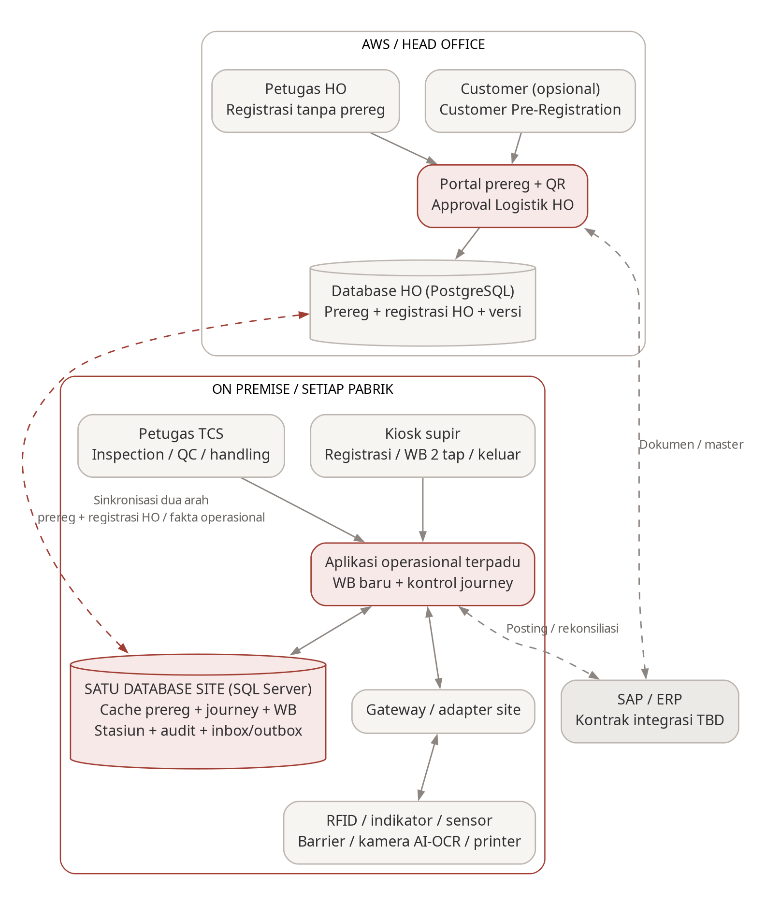

# Blueprint Sistem AWB-DWS

Dokumen ini adalah peta hidup AWB Downstream: komponen apa saja yang ada, sampai mana pembangunannya, dan keputusan teknis yang sudah diambil. Isinya bertambah bertahap seiring pekerjaan. Versi PDF untuk manajemen dibuat dari file ini dengan `npm run blueprint:pdf`.

## Cara memperbarui dokumen ini <!-- pdf:skip -->

Bagian ini untuk tim pengembang dan tidak ikut dicetak ke PDF.

Perbarui file ini **dalam perubahan yang sama** setiap kali Anda:

- menambah, mengganti nama atau menghapus aplikasi, domain, modul, fitur frontend, adapter perangkat atau paket bersama
- menambah atau mengubah endpoint, model Prisma, migrasi atau contract
- menyambungkan sistem luar (sinkronisasi HO, SAP, controller, kamera, printer)
- mengambil keputusan teknis yang perlu diketahui orang lain

Langkahnya:

1. Isi atau ubah baris di bagian yang sesuai. Di lampiran, tulis identifier sebagai inline code persis seperti yang dicetak `npm run check:blueprint` (pola modul: `<system>/<role>/domains/<domain>/<module>`).
2. Isi status: **direncanakan** (sudah disepakati, belum ada kode) · **kerangka** (sudah tersambung, logika masih sementara) · **dikerjakan** · **selesai** · **dihentikan**.
3. Cantumkan kebutuhan yang dipenuhi (PRD `FR-xxx`, `UI-xx`, keputusan `D-xx` atau hal terbuka `O-xx`) bila ada.
4. Perbarui bagian 2 dan 3 bila status sebuah komponen atau area berubah.
5. Tambahkan baris di "Riwayat perubahan" dengan nilai **sebelumnya**, **sekarang** dan **alasannya**.
6. Sebelum dibagikan ke manajemen, buat ulang PDF: `npm run blueprint:pdf` (sekali saja: `npm run docs:setup`).

Aturan riwayat, supaya kondisi awal tidak hilang:

- Bagian 1–3 dan lampiran menggambarkan **kondisi sekarang** dan boleh diubah. Nilai lamanya disimpan di "Riwayat perubahan".
- "Riwayat perubahan" **hanya boleh ditambah**. Baris lama tidak diubah atau dihapus; koreksi ditulis sebagai baris baru.
- Keputusan **tidak dihapus atau ditimpa**. Bila keputusan berubah, tambahkan keputusan baru (K-xx berikutnya) dan ubah status keputusan lama menjadi "digantikan oleh K-xx". Hanya kolom Status yang boleh berubah.

`npm run check` menjalankan `npm run check:blueprint`, yang gagal bila:

- kode memiliki sesuatu yang tidak tercantum di sini (aplikasi, domain, modul, model, migrasi, contract, fitur frontend, perangkat atau paket); endpoint dan keputusan tidak terdeteksi otomatis, jadi catat sendiri
- baris riwayat diubah atau dihapus, atau keputusan dihapus atau ditimpa, dibandingkan versi di commit terakhir (di CI, set `BLUEPRINT_BASE`, misalnya `origin/main`)
- file ini berubah tanpa baris baru di "Riwayat perubahan"

Pemeriksaan ini juga memberi peringatan bila PDF lebih lama dari file ini.

## 1. Ringkasan

AWB Downstream (AWB-DWS) menyatukan tiga aplikasi yang selama ini terpisah, yaitu Customer Pre-Registration, WB.NET (timbangan) dan TCS (kontrol tahap di pabrik), menjadi satu sistem yang mengatur perjalanan truk dari registrasi sampai keluar pabrik. Kebutuhan bisnis dan produknya dijelaskan dalam BRD v0.7 dan PRD v0.4.

Sistem berjalan di dua tempat. Customer Pre-Registration berjalan di AWS agar dapat diakses customer dan Logistik HO melalui internet. Sistem pabrik, yaitu registrasi, timbangan, TCS dan kiosk, berjalan on-premise di setiap pabrik sehingga operasional tetap berjalan ketika koneksi ke HO terputus. Kedua sisi bertukar data melalui sinkronisasi.

## 2. Komponen sistem

| Komponen | Fungsi | Berjalan di | Status |
|---|---|---|---|
| Portal Customer Pre-Registration | Pengajuan customer, approval Logistik HO dan registrasi oleh petugas HO | AWS | kerangka |
| Layanan Customer Pre-Registration | Menyimpan data pre-registration dan mengirimkannya ke pabrik | AWS · PostgreSQL | kerangka |
| Layanan pabrik | Satu backend untuk registrasi, timbangan pengganti WB.NET, TCS dan koneksi controller timbangan | On-premise · SQL Server | kerangka |
| Konsol staf pabrik | Layar timbangan, stasiun TCS, dashboard dan administrasi | On-premise | kerangka |
| Kiosk supir | Layar sentuh untuk registrasi, timbang dua tap dan keluar; hanya menampilkan, tidak menyimpan logika | On-premise | kerangka |
| Aplikasi Android petugas TCS | Input hasil inspection, sampling, lab dan loading/unloading; tampilan tetap seperti aplikasi lama | Perangkat petugas | direncanakan (backend dipindah ke layanan pabrik) |

## 3. Progres per area

| Area | Status | Keterangan |
|---|---|---|
| Fondasi teknis | selesai | Struktur repositori, aturan pemisahan modul, pengujian otomatis dan pemeriksaan blueprint berjalan. |
| Database | kerangka | PostgreSQL (AWS) dan SQL Server (pabrik) terpasang dengan migrasi awal; model data masih contoh dan akan diganti tabel yang disalin dari sistem lama (K-13). |
| Koneksi controller timbangan | dikerjakan | Koneksi ke setiap controller (2 per jembatan timbang) dan penyambungan ulang otomatis sudah berfungsi; format pesan sudah diketahui dari VCF, belum diterapkan. |
| Customer Pre-Registration | kerangka | Aplikasi dan database siap; fitur pengajuan, approval dan registrasi oleh petugas HO belum dibangun. Transaksi BEL (input PO) ditambahkan di samping JUL (K-15). |
| Registrasi masuk dan keluar | direncanakan | Mencakup QR, registrasi tanpa Customer Pre-Registration dan pengambilan kartu RFID. |
| Timbangan (pengganti WB.NET) | direncanakan | Dua tap, AI/OCR dan perhitungan berat; menunggu screenshot/walkthrough menu WB.NET (O-01) dan aturan AI/OCR (O-13). |
| TCS (tahap dan stasiun) | direncanakan | Alur BEL, JUL, LSK dan LSM beserta hasil petugas. Web Laravel digabung ke konsol pabrik; aplikasi Android tetap tampilannya (K-16). |
| Kiosk supir | kerangka | Layar contoh tersedia; tampilan status lane secara langsung belum dibangun. |
| Sinkronisasi HO dan pabrik | direncanakan | Format pesan sudah didefinisikan; pengiriman belum dibangun. |
| Integrasi SAP | direncanakan | Menunggu kontrak integrasi (O-07). |

## 4. Keputusan teknis

Keputusan tidak pernah dihapus. Keputusan yang berubah tetap tercantum dengan status "digantikan oleh K-xx".

| ID | Tanggal | Keputusan | Alasan | Status |
|---|---|---|---|---|
| K-01 | 2026-11-02 | Satu repositori; aplikasi dikelompokkan per sistem (`apps/prereg`, `apps/site`) | Ketiga aplikasi lama berada di satu tempat dengan pemisahan yang jelas | berlaku |
| K-02 | 2026-11-02 | WB.NET dan TCS menjadi domain di dalam satu layanan pabrik, bukan aplikasi terpisah | Keduanya memakai satu database pabrik dan harus tersimpan bersamaan | berlaku |
| K-03 | 2026-11-02 | Usulan awal: aplikasi gateway terpisah untuk perangkat timbangan | Memisahkan koneksi perangkat dari layanan utama | digantikan oleh K-04 |
| K-04 | 2026-11-02 | Koneksi perangkat ada di layanan pabrik (TCP ke controller, 2 per jembatan timbang); kiosk hanya menampilkan | Keputusan pemilik kebutuhan | berlaku |
| K-05 | 2026-11-02 | Usulan awal: pnpm workspaces | Aturan dependensi yang lebih ketat | digantikan oleh K-06 |
| K-06 | 2026-11-02 | npm workspaces dan Turborepo | Preferensi pemilik | berlaku |
| K-07 | 2026-11-02 | TypeScript 7 (versi terbaru) | Versi terbaru saat kerangka dibuat | digantikan oleh K-08 |
| K-08 | 2026-11-02 | TypeScript dikunci di versi 6.0 | dependency-cruiser dan typescript-eslint belum mendukung TypeScript 7 | berlaku |
| K-09 | 2026-11-02 | Aturan pemisahan modul diperiksa otomatis (dependency-cruiser) | Menjaga batas antar aplikasi, domain, perangkat dan akses data | berlaku |
| K-10 | 2026-11-02 | Customer Pre-Registration memakai PostgreSQL; seluruh sistem on-premise memakai SQL Server (PRD D-19) | Keputusan pemilik kebutuhan | berlaku |
| K-11 | 2026-11-02 | Prisma 7.10.1 dengan driver adapter | Rilis stabil; tag `latest` di npm menunjuk ke kandidat rilis 8.0 | berlaku |
| K-12 | 2026-11-02 | Blueprint dengan riwayat yang tidak ditimpa, diperiksa otomatis dan dicetak sebagai PDF | Manajemen dapat melihat kondisi terkini sekaligus perjalanan perubahannya | berlaku |
| K-13 | 2026-11-02 | Database baru untuk Customer Pre-Registration (PostgreSQL) dan pabrik (SQL Server); struktur tabel disalin dari sistem lama (customer_prereg, VCF, WB.NET), tidak harus semua dan boleh diubah | Keputusan pemilik kebutuhan | berlaku |
| K-14 | 2026-11-02 | Format pesan controller diambil dari VCF; controller di Priscolin diasumsikan bertipe sama | Keputusan pemilik kebutuhan; dipastikan saat survei/FAT | digantikan oleh K-17 |
| K-15 | 2026-11-02 | Customer Pre-Registration ditambah transaksi BEL (beli): alurnya sama dengan JUL, tetapi yang diinput adalah PO, bukan DO/Kontrak | Aplikasi lama hanya mendukung JUL | berlaku |
| K-16 | 2026-11-02 | Web Laravel TCS digabung ke konsol pabrik (`site/web`); aplikasi Android TCS tampilannya tetap, tetapi backend dan database-nya pindah ke layanan pabrik | Satu sistem dan satu database per pabrik | berlaku |
| K-17 | 2026-11-02 | Format tap RFID dan perintah controller sama persis dengan VCF (boleh diperbaiki bila perlu); logika sensor auto-close barrier dapat berubah karena jenis sensor berbeda | Keputusan pemilik kebutuhan | berlaku |
| K-18 | 2026-11-02 | Acuan struktur customer_prereg adalah branch `dev_1.3.1/bc`, ditambah 2 perbaikan terbaru di `production` | `bc` 66 commit lebih maju, cocok dengan database dan sudah mendukung PO sebagian | berlaku |
| K-19 | 2026-11-02 | Master supir, kendaraan dan transporter dikelola di Customer Pre-Registration (HO) dan dikirim ke pabrik tujuan saat Logistik approve; integrasi SAP menyusul | Keputusan pemilik kebutuhan | berlaku |
| K-20 | 2026-11-02 | Layanan pabrik menyediakan API dengan alamat dan format yang sama dengan VCF untuk aplikasi Android | Aplikasi cukup diganti alamat servernya | berlaku |
| K-21 | 2026-11-02 | Akses SAP memakai akun layanan; password SAP pengguna tidak disimpan (`session_sap` tidak dipakai) | Keputusan pemilik kebutuhan | berlaku |

## 5. Riwayat perubahan

Riwayat hanya ditambah, tidak pernah diubah atau dihapus, sehingga kondisi awal setiap perubahan tetap dapat dilihat.

| No | Tanggal | Area | Sebelumnya | Sekarang | Alasan / referensi |
|---|---|---|---|---|---|
| R-001 | 2026-11-02 | Kebutuhan: registrasi | Setiap truk wajib memiliki Customer Pre-Registration yang disetujui (PRD v0.2) | Customer Pre-Registration opsional; data registrasi juga dapat diisi supir atau petugas HO | BRD v0.7 D-15; PRD v0.3 |
| R-002 | 2026-11-02 | Kebutuhan: penimbangan | Satu tap kartu; berat direkam otomatis ketika syarat terpenuhi (PRD v0.2) | Dua tap di kiosk dalam area timbangan: tap pertama menampilkan data, tap kedua merekam berat | BRD v0.7 D-16; PRD v0.3 |
| R-003 | 2026-11-02 | Kebutuhan: AI/OCR | Objek yang terdeteksi selalu menahan penimbangan (PRD v0.2) | AI memeriksa posisi, perimeter dan orang; OCR mencocokkan pelat; tindakan atas hasilnya mengikuti kebijakan yang belum ditetapkan | BRD v0.7 D-16; PRD v0.3; O-13 |
| R-004 | 2026-11-02 | Repositori | — | Kerangka repositori: aplikasi prereg dan site, paket bersama, aturan pemisahan modul dan pengujian | K-01, K-02, K-09 |
| R-005 | 2026-11-02 | Perangkat | Usulan aplikasi gateway terpisah untuk perangkat | Koneksi TCP ke controller di layanan pabrik; kiosk hanya tampilan | K-03 → K-04 |
| R-006 | 2026-11-02 | Tooling | Usulan pnpm; TypeScript 7 | npm workspaces; TypeScript 6.0 | K-05 → K-06; K-07 → K-08 |
| R-007 | 2026-11-02 | Database | Engine belum ditetapkan (PRD O-06); repository menyimpan data sementara di memori | PostgreSQL untuk Customer Pre-Registration dan SQL Server untuk pabrik, dengan migrasi awal | PRD D-19, PRD v0.4; K-10, K-11 |
| R-008 | 2026-11-02 | Dokumentasi | — | Blueprint dengan pemeriksaan otomatis, riwayat yang tidak ditimpa dan versi PDF | K-12 |
| R-009 | 2026-11-02 | Database | Belum ditentukan apakah memakai database lama atau baru | Database baru; struktur tabel disalin secara selektif dari sistem lama dan boleh diubah | K-13 |
| R-010 | 2026-11-02 | Perangkat | Format pesan controller belum diketahui | Format diambil dari VCF (`:W1<kartu>!`, `:INPn!`, `:PING!`, `:OPENn!`); belum diterapkan | K-14 |
| R-011 | 2026-11-02 | Dokumentasi | — | Bagian "Hal yang belum diputuskan" ditambahkan; pemindahan data lama, perpindahan sistem dan server cadangan ditunda | Keputusan pemilik kebutuhan |
| R-012 | 2026-11-02 | Customer Pre-Registration | Hanya transaksi JUL (input DO/Kontrak) | JUL dan BEL; BEL memakai input PO dengan alur yang sama | K-15 |
| R-013 | 2026-11-02 | TCS | Web Laravel dan aplikasi Android memakai backend dan database VCF | Web digabung ke konsol pabrik; aplikasi Android tetap tampilannya, backend dan database pindah ke layanan pabrik | K-16 |
| R-014 | 2026-11-02 | Perangkat | Controller Priscolin diasumsikan sama dengan VCF | Format tap RFID dan perintah sama persis; logika sensor auto-close barrier dapat berubah | K-14 → K-17 |
| R-015 | 2026-11-02 | Dokumentasi | — | Inventaris tabel sistem lama (usulan salin/ubah/tidak dipakai) dan protokol controller lengkap ditulis di `docs/design/` | K-13, K-17 |
| R-016 | 2026-11-02 | Database | 6 pertanyaan terbuka di inventaris tabel; API aplikasi Android belum diputuskan | 4 diputuskan: acuan branch, master supir/kendaraan/transporter di HO, API meniru VCF, akun layanan SAP; layar re-adopt dan ekspor struktur WB.NET masih terbuka | K-18 s.d. K-21 |

## 6. Hal yang belum diputuskan

| Hal | Status | Keterangan |
|---|---|---|
| Tabel yang disalin dari sistem lama dan perubahannya | draf ditinjau | `docs/design/inventaris-tabel.md`; 4 dari 6 pertanyaan sudah dijawab (K-18 s.d. K-21) |
| Layar re-adopt di aplikasi Android | belum diputuskan | Dihilangkan, atau dipakai untuk koreksi data tiket di sistem baru |
| Ekspor struktur tabel WB.NET (tanpa data) | tindak lanjut | Kemungkinan bisa; dibutuhkan agar fungsi timbangan baru setara WB.NET (PRD O-01) |
| Pemindahan data lama (WB.NET, VCF, customer_prereg) | ditunda | Dibahas nanti (PRD O-06) |
| Cara perpindahan sistem, termasuk truk yang sedang di dalam pabrik | ditunda | Dibahas nanti (PRD O-06) |
| Server cadangan bila server pabrik mati | ditunda | Sampai diputuskan, layanan pabrik hanya boleh berjalan 1 salinan per pabrik karena memegang koneksi controller (PRD O-09) |
| Fungsi tiap relay (`OPEN1`, `OPEN4`, ...) dan sisi tiap controller | perlu dicek | Dipastikan saat survei/FAT di Priscolin (PRD O-05) |
| Jenis sensor dan logika auto-close barrier | perlu dicek | Sensor di Priscolin berbeda dari VCF (K-17) |

## Lampiran A. Aplikasi

| Aplikasi | Paket | Berjalan di | Port (dev) | Database | Status |
|---|---|---|---|---|---|
| `prereg/api` | `@awb/prereg-api` | AWS ECS, publik | 3000 | PostgreSQL | kerangka |
| `prereg/web` | `@awb/prereg-web` | AWS, publik | 5173 | — | kerangka |
| `site/api` | `@awb/site-api` | On-premise, tepat satu instance per pabrik | 4000 | SQL Server | kerangka |
| `site/web` | `@awb/site-web` | On-premise | 5174 | — | kerangka |
| `site/kiosk` | `@awb/site-kiosk` | On-premise, layar sentuh kiosk (hanya tampilan) | 5175 | — | kerangka |

## Lampiran B. Domain dan modul backend

### site/api

| Domain | Cakupan | PRD | Status |
|---|---|---|---|
| `site/api/domains/journey` | Satu catatan per kunjungan truk: tahap saat ini, pengikatan kartu, audit | FR-008–FR-010, FR-043 | kerangka |
| `site/api/domains/registration` | Reg IN dan Reg OUT, cache prereg, QR, fallback QR, registrasi tanpa prereg, keluar | FR-001–FR-010, FR-027, FR-029, FR-045–FR-047 | direncanakan (router saja) |
| `site/api/domains/weighbridge` | Pengganti WB.NET: tap 1/2, penimbangan, OCR, pemeriksaan AI, toleransi, tiket | FR-011–FR-019, FR-028, FR-048–FR-050 | direncanakan (router saja) |
| `site/api/domains/tcs` | Alur yang dapat dikonfigurasi, tahap, input stasiun, keputusan QC | FR-020–FR-026 | direncanakan (router saja) |
| `site/api/domains/sync` | Outbox/inbox dengan HO, rekonsiliasi, klien prereg | FR-031–FR-036 | direncanakan (router saja) |
| `site/api/domains/erp` | Posting ke SAP (keluar saja) | FR-037, O-07 | direncanakan |

| Modul | Fungsi | Status |
|---|---|---|
| `site/api/domains/journey/journey` | Membaca journey berdasarkan id | kerangka |

### prereg/api

| Modul | Fungsi | PRD | Status |
|---|---|---|---|
| `prereg/api/modules/pre-registration` | Membaca Customer Pre-Registration berdasarkan id | FR-001 | kerangka |

## Lampiran C. Endpoint API

| Aplikasi | Metode | Path | Modul | Contract | Status |
|---|---|---|---|---|---|
| site/api | GET | `/health` | `src/app.ts` | — | selesai (termasuk status koneksi controller) |
| site/api | GET | `/api/journeys/:id` | journey/journey | — | kerangka |
| site/api | — | `/api/registration`, `/api/weighbridge`, `/api/tcs`, `/api/sync` | router domain | — | direncanakan (terpasang, belum ada route) |
| prereg/api | GET | `/health` | `src/app.ts` | — | selesai |
| prereg/api | GET | `/api/pre-registrations/:id` | pre-registration | — | kerangka |
| prereg/api | — | `/api/internal/*` | `src/routes/internal.ts` | contract sinkronisasi | direncanakan (route antar layanan untuk pabrik; perlu autentikasi layanan) |

## Lampiran D. Model data dan migrasi

| Model | Aplikasi · database | Tabel | Pemilik | Status |
|---|---|---|---|---|
| `Journey` | site/api · SQL Server | `journeys` | domain journey | field contoh |
| `PreRegistration` | prereg/api · PostgreSQL | `pre_registrations` | modul pre-registration | field contoh; diganti tabel yang disalin dari customer_prereg (K-13) |

| Migrasi | Aplikasi | Isi |
|---|---|---|
| `20261102042317_init` | prereg/api | Membuat tabel `pre_registrations` |
| `20261102042905_init` | site/api | Membuat tabel `journeys` dengan indeks (`site_id`, `status`) |

## Lampiran E. Contract (format data antar aplikasi)

Skema di `@awb/contracts`; penjelasannya ada di README, bagian "Shared packages".

| Skema | File | Dari → ke | Status |
|---|---|---|---|
| `transactionType` | `common/transaction.ts` | semua aplikasi | terdefinisi |
| `registrationOrigin` | `common/transaction.ts` | semua aplikasi | terdefinisi |
| `syncEnvelope` | `sync/envelope.ts` | prereg ↔ site | terdefinisi, belum dikirim |
| `preregApprovedPayload` | `sync/prereg-approved.ts` | prereg → site | terdefinisi, belum dikirim |
| `preregApprovedEvent` | `sync/prereg-approved.ts` | prereg → site | terdefinisi, belum dikirim |
| `wbSessionPhase` | `realtime/lane-event.ts` | site/api → site/kiosk | terdefinisi |
| `laneScreenEvent` | `realtime/lane-event.ts` | site/api → site/kiosk | terdefinisi, belum dikirim |

## Lampiran F. Fitur frontend

| Fitur | Layar PRD | Status |
|---|---|---|
| `prereg/web/features/pre-registration` | UI-01 | halaman contoh |
| `prereg/web/features/approval` | UI-02 | halaman contoh |
| `prereg/web/features/ho-registration` | UI-18 | halaman contoh |
| `site/web/features/weighbridge` | Menu WB.NET (daftar parity O-01) | halaman contoh |
| `site/web/features/tcs` | UI-10, UI-11 | halaman contoh |
| `site/web/features/dashboard` | UI-14, UI-15 | halaman contoh |
| `site/web/features/admin` | UI-16 | halaman contoh |
| `site/kiosk/features/registration` | UI-03–UI-07, UI-17 | layar contoh |
| `site/kiosk/features/weighing` | UI-08, UI-19, UI-09 | layar contoh |
| `site/kiosk/features/exit` | UI-12, UI-13 | layar contoh |

## Lampiran G. Perangkat dan integrasi

| Item | Fungsi | Status |
|---|---|---|
| `site/api/devices/controller` | Satu koneksi TCP per controller timbangan (2 per jembatan timbang), sambung ulang otomatis, status di `/health`, `sendToController()` untuk perintah | koneksi selesai; format pesan dicatat di `docs/design/protokol-controller.md`, belum diterapkan (data mentah saja) |
| Sinkronisasi HO ↔ pabrik | Outbox/inbox dengan contract sinkronisasi | direncanakan |
| SAP / ERP | Posting hasil yang diterima | direncanakan (kontrak terbuka, O-07) |
| Tampilan realtime kiosk (`site/api/src/realtime`) | Mengirim status lane ke layar kiosk | direncanakan |
| Kamera AI/OCR, indikator, printer | Adapter perangkat | direncanakan (O-05, O-13) |

## Lampiran H. Paket bersama

| Paket | Isi | Status |
|---|---|---|
| `packages/contracts` | Skema zod antar aplikasi (Lampiran E) | dikerjakan |
| `packages/server-core` | `CustomError`, `NotFoundError`, `ValidationError`, `errorHandler`, `success()`, `loadEnv()` | selesai untuk saat ini |
| `packages/ui` | `AppShell`, `Screen` | kerangka |
