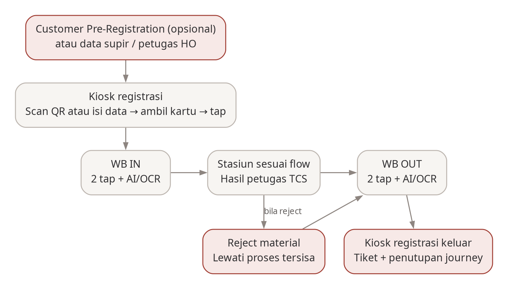

# Blueprint Sistem AWB-DWS

Ringkasan kondisi proyek AWB Downstream untuk manajemen: apa yang dibangun, sampai mana progresnya, keputusan penting dan hal yang masih perlu diputuskan. Rincian teknis untuk tim pengembang ada di `TECHNICAL.md`.

## Cara memperbarui dokumen ini <!-- pdf:skip -->

Bagian ini tidak ikut dicetak ke PDF. Aturan lengkapnya ada di `TECHNICAL.md`, bagian "Cara memperbarui".

- Tulis dengan bahasa sederhana, tanpa istilah teknis. Hal teknis masuk ke `TECHNICAL.md`.
- Status progres: **Belum mulai** · **Persiapan** (struktur dasar sudah disiapkan) · **Dikerjakan** · **Selesai**.
- Keputusan dan riwayat tidak pernah dihapus atau ditimpa. Nomor K-xx dan R-xx dipakai bersama dengan `TECHNICAL.md`.
- Sebelum dibagikan, buat ulang PDF: `npm run blueprint:pdf`.

## 1. Ringkasan

AWB Downstream (AWB-DWS) menyatukan tiga aplikasi yang selama ini terpisah: Customer Pre-Registration (pendaftaran truk oleh customer), WB.NET (timbangan) dan TCS (kontrol pemeriksaan serta bongkar/muat di pabrik). Hasilnya satu sistem yang mengatur perjalanan truk dari pendaftaran sampai keluar pabrik. Kebutuhannya dijelaskan dalam BRD v0.7 dan PRD v0.4.

Sistem berjalan di dua tempat:

- **Customer Pre-Registration** berjalan di internet (AWS), supaya customer dan Logistik HO bisa mengaksesnya dari mana saja.
- **Sistem pabrik** (registrasi, timbangan, TCS dan kiosk) berjalan di server setiap pabrik, supaya operasional tetap jalan walaupun koneksi ke HO terputus.

Kedua sisi saling bertukar data secara otomatis.

## 2. Komponen sistem

| Komponen                         | Untuk siapa dan fungsinya                                                                               | Lokasi            | Status      |
| -------------------------------- | ------------------------------------------------------------------------------------------------------- | ----------------- | ----------- |
| Portal Customer Pre-Registration | Customer mendaftarkan truk, Logistik HO menyetujui, petugas HO mendaftarkan truk tanpa pre-registration | Internet (AWS)    | Persiapan   |
| Sistem pabrik                    | Mengatur registrasi, timbangan pengganti WB.NET, pemeriksaan TCS dan perangkat timbangan                | Server pabrik     | Persiapan   |
| Konsol petugas pabrik            | Layar untuk operator timbangan, petugas TCS, dashboard dan admin                                        | Pabrik            | Persiapan   |
| Kiosk supir                      | Layar sentuh untuk supir: registrasi, timbang dengan dua tap kartu, dan keluar                          | Pabrik            | Persiapan   |
| Aplikasi Android petugas TCS     | Input hasil pemeriksaan, sampling, lab dan bongkar/muat; tampilannya tetap seperti sekarang             | HP/tablet petugas | Belum mulai |

## 3. Progres per area

| Area                               | Status      | Keterangan                                                                                                                                                                                                                                                                                                                                                                                                                                                                                                                                                                                                                                                                                                                                                                                                                                                                                                                                                                                                                                                                                                                   |
| ---------------------------------- | ----------- | ---------------------------------------------------------------------------------------------------------------------------------------------------------------------------------------------------------------------------------------------------------------------------------------------------------------------------------------------------------------------------------------------------------------------------------------------------------------------------------------------------------------------------------------------------------------------------------------------------------------------------------------------------------------------------------------------------------------------------------------------------------------------------------------------------------------------------------------------------------------------------------------------------------------------------------------------------------------------------------------------------------------------------------------------------------------------------------------------------------------------------- |
| Fondasi proyek                     | Selesai     | Struktur proyek, aturan kerja tim, pengujian otomatis dan dokumen ini sudah siap.                                                                                                                                                                                                                                                                                                                                                                                                                                                                                                                                                                                                                                                                                                                                                                                                                                                                                                                                                                                                                                            |
| Database                           | Dikerjakan  | Tabel akun, supir, kendaraan, pengajuan dan dokumen tersedia di pusat; penyimpanan master supir/kendaraan dan penerimaan data tersedia di database pabrik.                                                                                                                                                                                                                                                                                                                                                                                                                                                                                                                                                                                                                                                                                                                                                                                                                                                                                                                                                                   |
| Koneksi ke perangkat timbangan     | Dikerjakan  | Sistem sudah bisa tersambung ke controller timbangan (2 per jembatan timbang) dan menyambung ulang sendiri bila putus. Pembacaan tap kartu belum dibuat.                                                                                                                                                                                                                                                                                                                                                                                                                                                                                                                                                                                                                                                                                                                                                                                                                                                                                                                                                                     |
| Customer Pre-Registration          | Dikerjakan  | Form pengajuan supir/kendaraan dan revisi penolakan tersedia. Alur JUL (pilih DO, cek DP dan kuota, review Logistik sampai nomor loading note) sudah dibuat dan diuji dengan data simulasi. Alur BEL untuk vendor (pilih item PO dari SAP tanpa cek DP, batasan kuota PO, pilih supir/truk SAP, review Logistik dan penulisan ke staging Oracle BEL tanpa loading note otomatis) sudah dibuat; daftar PO sudah dibaca dari SAP development. JUL hanya untuk customer. Admin dapat mengunduh daftar supir dan truk yang terdaftar di SAP, dan saat membuat registrasi hanya supir dan truk yang sudah terdaftar di SAP yang bisa dipilih dengan cara mengetik untuk mencari; unduhan lengkap menunggu SAP menyediakan pengambilan data bertahap. Supir dan kendaraan diajukan terpisah seperti aplikasi lama, masing-masing dengan plant tujuan, di satu halaman dengan tab Supir dan Kendaraan; Logistik atau admin menyetujui (dengan catatan) atau menolak (dengan alasan) di halaman yang sama. Pengiriman supir/truk yang disetujui ke SAP dan ke pabrik setelah SAP mengonfirmasi belum selesai; OTP dan email ditunda. |
| Registrasi masuk dan keluar        | Dikerjakan  | Konsol pabrik punya login operator, daftar registrasi truk, form registrasi baru yang sederhana dan halaman Data master. Seperti di WB System, plat, supir, pengangkutan, tangki, tujuan, DO dan kode QC dipilih dari data master SAP; memilih DO mengisi otomatis komoditi, pembeli/penjual, kontrak dan spesifikasi mutu. Data master sudah diisi dari WB.NET; dari SAP baru truk dan pembeli/penjual yang bisa ditarik. Belum: isi otomatis dari QR pre-registration (AWB) atau foto dokumen (VCF), revisi, pembatalan, registrasi keluar dan kartu RFID.                                                                                                                                                                                                                                                                                                                                                                                                                                                                                                                                                                 |
| Timbangan (pengganti WB.NET)       | Belum mulai | Dua tap kartu, kamera AI/OCR dan perhitungan berat. Menunggu daftar menu WB.NET dan aturan kamera AI/OCR.                                                                                                                                                                                                                                                                                                                                                                                                                                                                                                                                                                                                                                                                                                                                                                                                                                                                                                                                                                                                                    |
| TCS (pemeriksaan dan bongkar/muat) | Belum mulai | Alur BEL, JUL, LSK dan LSM. Web TCS digabung ke konsol pabrik; aplikasi Android tetap tampilannya (K-16).                                                                                                                                                                                                                                                                                                                                                                                                                                                                                                                                                                                                                                                                                                                                                                                                                                                                                                                                                                                                                    |
| Kiosk supir                        | Persiapan   | Layar contoh sudah ada; tampilan status timbangan secara langsung belum dibuat.                                                                                                                                                                                                                                                                                                                                                                                                                                                                                                                                                                                                                                                                                                                                                                                                                                                                                                                                                                                                                                              |
| Pertukaran data HO dan pabrik      | Dikerjakan  | Pengambilan master supir/kendaraan yang disetujui tersedia dan diuji lokal; aktivasi per pabrik menunggu konfigurasi koneksi dan pengujian lokasi.                                                                                                                                                                                                                                                                                                                                                                                                                                                                                                                                                                                                                                                                                                                                                                                                                                                                                                                                                                           |
| Integrasi SAP                      | Dikerjakan  | Pembuatan loading note JUL lewat SAP sudah dibuat dan diuji dengan data simulasi. Uji coba ke SAP development belum dilakukan; cara login ke SAP sesuai K-22.                                                                                                                                                                                                                                                                                                                                                                                                                                                                                                                                                                                                                                                                                                                                                                                                                                                                                                                                                                |

## 4. Keputusan penting

Keputusan yang berdampak ke bisnis dan operasional. Keputusan tidak pernah dihapus; keputusan yang berubah tetap tercantum dengan status "digantikan oleh K-xx". Keputusan teknis ada di `TECHNICAL.md`.

| ID   | Tanggal    | Keputusan                                                                                                                                                                                                                                                                                                                                                                                                                                                                                                            | Alasan                                                                                                              | Status               |
| ---- | ---------- | -------------------------------------------------------------------------------------------------------------------------------------------------------------------------------------------------------------------------------------------------------------------------------------------------------------------------------------------------------------------------------------------------------------------------------------------------------------------------------------------------------------------- | ------------------------------------------------------------------------------------------------------------------- | -------------------- |
| K-10 | 2026-11-02 | Customer Pre-Registration memakai PostgreSQL; seluruh sistem on-premise memakai SQL Server (PRD D-19)                                                                                                                                                                                                                                                                                                                                                                                                                | Keputusan pemilik kebutuhan                                                                                         | berlaku              |
| K-13 | 2026-11-02 | Database baru untuk Customer Pre-Registration (PostgreSQL) dan pabrik (SQL Server); struktur tabel disalin dari sistem lama (customer_prereg, VCF, WB.NET), tidak harus semua dan boleh diubah                                                                                                                                                                                                                                                                                                                       | Keputusan pemilik kebutuhan                                                                                         | berlaku              |
| K-15 | 2026-11-02 | Customer Pre-Registration ditambah transaksi BEL (beli): alurnya sama dengan JUL, tetapi yang diinput adalah PO, bukan DO/Kontrak                                                                                                                                                                                                                                                                                                                                                                                    | Aplikasi lama hanya mendukung JUL                                                                                   | berlaku              |
| K-16 | 2026-11-02 | Web Laravel TCS digabung ke konsol pabrik (`site/web`); aplikasi Android TCS tampilannya tetap, tetapi backend dan database-nya pindah ke layanan pabrik                                                                                                                                                                                                                                                                                                                                                             | Satu sistem dan satu database per pabrik                                                                            | berlaku              |
| K-19 | 2026-11-02 | Master supir, kendaraan dan transporter dikelola di Customer Pre-Registration (HO) dan dikirim ke pabrik tujuan saat Logistik approve; integrasi SAP menyusul                                                                                                                                                                                                                                                                                                                                                        | Keputusan pemilik kebutuhan                                                                                         | digantikan oleh K-41 |
| K-21 | 2026-11-02 | Akses SAP memakai akun layanan; password SAP pengguna tidak disimpan (`session_sap` tidak dipakai)                                                                                                                                                                                                                                                                                                                                                                                                                   | Keputusan pemilik kebutuhan                                                                                         | digantikan oleh K-22 |
| K-22 | 2026-11-02 | Saat Logistik approve, data dikirim ke SAP dengan akun SAP petugas yang approve, seperti aplikasi lama; akses SAP lainnya memakai satu akun SAP bersama, sama seperti aplikasi Warehouse Management                                                                                                                                                                                                                                                                                                                  | Keputusan pemilik kebutuhan                                                                                         | berlaku              |
| K-41 | 2026-11-09 | Master supir, kendaraan dan transporter dikelola di Customer Pre-Registration (HO). Customer memilih plant tujuan dari plant miliknya saat mengajukan; Logistik atau admin menyetujui atau menolak; data yang disetujui dikirim ke SAP dan baru dikirim ke plant tujuan setelah SAP mengonfirmasi. Supir dan truk yang terdaftar di SAP berlaku untuk semua plant saat registrasi                                                                                                                                    | Keputusan pemilik kebutuhan                                                                                         | berlaku              |
| K-46 | 2026-11-11 | JUL hanya untuk customer; vendor mendaftar lewat BEL. Staf internal juga tidak bisa membuat JUL atas nama vendor                                                                                                                                                                                                                                                                                                                                                                                                     | Vendor bekerja dengan PO, bukan DO; keputusan pemilik                                                               | berlaku              |
| K-48 | 2026-11-11 | Form registrasi di pabrik memuat semua isian WB System dan juga akan dipakai untuk VCF, tetapi tampilannya tidak meniru WB System: dibuat sesederhana mungkin untuk operator. Di AWB isinya diambil dari QR pre-registration, di VCF dari foto dokumen supir; sampai itu siap, operator mengetik semua isian. Konsol pabrik punya login operator sendiri                                                                                                                                                             | Tidak ada isian WB System yang hilang, operator lebih mudah mengisi, dan satu form dipakai untuk dua cara pengisian | berlaku              |
| K-50 | 2026-11-12 | Semua data master di pabrik (truk, supir, DO, komoditi, pembeli/penjual dan lainnya) hanya diambil dari SAP, dengan catatan waktu tarik terakhir. Customer Pre-Registration mengirim data ke SAP sendiri; kiriman langsung dari pre-registration ke pabrik tetap berjalan tetapi hanya sebagai cadangan untuk mode offline nanti. Menjelang go-live, data terbaru WB.NET disalin satu kali ke sistem baru dan dianggap data SAP; master yang belum punya layanan SAP menampilkan pesan "belum tersedia" saat ditarik | SAP menjadi satu-satunya sumber data; WB.NET tidak dipakai lagi setelah go-live                                     | berlaku              |

## 5. Hal yang perlu diputuskan

| Hal                                 | Status            | Keterangan                                                                                                                                                                     |
| ----------------------------------- | ----------------- | ------------------------------------------------------------------------------------------------------------------------------------------------------------------------------ |
| Tabel yang diambil dari sistem lama | Sedang ditinjau   | Usulan sudah dibuat; 4 dari 6 pertanyaan sudah dijawab.                                                                                                                        |
| Layar re-adopt di aplikasi Android  | Belum diputuskan  | Layar untuk mengambil ulang data tiket dari WB.NET: dihilangkan, atau dipakai untuk koreksi data tiket di sistem baru.                                                         |
| Struktur database WB.NET            | Selesai sebagian  | Struktur dan data master WB.NET dev sudah bisa dibaca (akses hanya baca) dan disalin ke sistem baru; struktur transaksi timbang menyusul.                                      |
| Layanan SAP untuk data master       | Menunggu SAP      | Belum ada layanan SAP untuk daftar DO per pabrik, daftar supir, pengangkutan, tangki, tujuan, komoditi, kebun, tipe transaksi dan item QC. Sementara data diambil dari WB.NET. |
| Pemindahan data lama                | Ditunda           | Data dari WB.NET, TCS dan Customer Pre-Registration lama.                                                                                                                      |
| Cara pindah ke sistem baru          | Ditunda           | Termasuk truk yang sedang berada di dalam pabrik saat pergantian.                                                                                                              |
| Server cadangan pabrik              | Ditunda           | Saat ini setiap pabrik memakai satu server; bila server mati, timbangan berhenti.                                                                                              |
| Fungsi relay dan sisi controller    | Dicek saat survei | Dipastikan saat survei di Priscolin.                                                                                                                                           |
| Sensor penutup palang otomatis      | Dicek saat survei | Jenis sensor di Priscolin berbeda dari pabrik lain.                                                                                                                            |

## 6. Riwayat perubahan

Riwayat hanya ditambah, tidak pernah diubah atau dihapus, sehingga kondisi awal setiap perubahan tetap dapat dilihat. Riwayat teknis ada di `TECHNICAL.md`.

| No    | Tanggal    | Area                                                    | Sebelumnya                                                                                                                    | Sekarang                                                                                                                                                                                                                                                                                                                                                                                                                                     | Alasan / referensi                             |
| ----- | ---------- | ------------------------------------------------------- | ----------------------------------------------------------------------------------------------------------------------------- | -------------------------------------------------------------------------------------------------------------------------------------------------------------------------------------------------------------------------------------------------------------------------------------------------------------------------------------------------------------------------------------------------------------------------------------------- | ---------------------------------------------- |
| R-001 | 2026-11-02 | Kebutuhan: registrasi                                   | Setiap truk wajib memiliki Customer Pre-Registration yang disetujui (PRD v0.2)                                                | Customer Pre-Registration opsional; data registrasi juga dapat diisi supir atau petugas HO                                                                                                                                                                                                                                                                                                                                                   | BRD v0.7 D-15; PRD v0.3                        |
| R-002 | 2026-11-02 | Kebutuhan: penimbangan                                  | Satu tap kartu; berat direkam otomatis ketika syarat terpenuhi (PRD v0.2)                                                     | Dua tap di kiosk dalam area timbangan: tap pertama menampilkan data, tap kedua merekam berat                                                                                                                                                                                                                                                                                                                                                 | BRD v0.7 D-16; PRD v0.3                        |
| R-003 | 2026-11-02 | Kebutuhan: AI/OCR                                       | Objek yang terdeteksi selalu menahan penimbangan (PRD v0.2)                                                                   | AI memeriksa posisi, perimeter dan orang; OCR mencocokkan pelat; tindakan atas hasilnya mengikuti kebijakan yang belum ditetapkan                                                                                                                                                                                                                                                                                                            | BRD v0.7 D-16; PRD v0.3; O-13                  |
| R-009 | 2026-11-02 | Database                                                | Belum ditentukan apakah memakai database lama atau baru                                                                       | Database baru; struktur tabel disalin secara selektif dari sistem lama dan boleh diubah                                                                                                                                                                                                                                                                                                                                                      | K-13                                           |
| R-011 | 2026-11-02 | Dokumentasi                                             | —                                                                                                                             | Bagian "Hal yang belum diputuskan" ditambahkan; pemindahan data lama, perpindahan sistem dan server cadangan ditunda                                                                                                                                                                                                                                                                                                                         | Keputusan pemilik kebutuhan                    |
| R-012 | 2026-11-02 | Customer Pre-Registration                               | Hanya transaksi JUL (input DO/Kontrak)                                                                                        | JUL dan BEL; BEL memakai input PO dengan alur yang sama                                                                                                                                                                                                                                                                                                                                                                                      | K-15                                           |
| R-013 | 2026-11-02 | TCS                                                     | Web Laravel dan aplikasi Android memakai backend dan database VCF                                                             | Web digabung ke konsol pabrik; aplikasi Android tetap tampilannya, backend dan database pindah ke layanan pabrik                                                                                                                                                                                                                                                                                                                             | K-16                                           |
| R-018 | 2026-11-02 | Akses SAP                                               | Semua akses SAP memakai satu akun layanan (K-21)                                                                              | Saat Logistik approve memakai akun SAP petugas; akses SAP lainnya memakai satu akun bersama seperti Warehouse Management                                                                                                                                                                                                                                                                                                                     | K-21 → K-22                                    |
| R-040 | 2026-11-05 | Akun dan akses                                          | Login/pengelolaan akun sebagian berupa contoh; pemulihan password diklaim melalui email                                       | Akun dan hak akses disatukan, akses pengguna diperiksa, data tersimpan dan pengujian ditambah. OTP dan pengiriman email ditunda; untuk pengembangan kredensial tersedia di komputer pengembang. Pembuatan/reset akun pada produksi menunggu pengiriman kredensial                                                                                                                                                                            | Permintaan pemilik; K-29 s.d. K-31             |
| R-069 | 2026-11-06 | Pengajuan dan pertukaran data pabrik                    | Form pengajuan dan pengiriman master ke pabrik belum tersedia                                                                 | Form supir/kendaraan, revisi penolakan dan pengambilan master yang disetujui ditambahkan serta diperbaiki setelah review. Persetujuan lengkap, alur JUL dan aktivasi koneksi pabrik masih terpisah                                                                                                                                                                                                                                           | Integrasi pekerjaan tim dan permintaan pemilik |
| R-072 | 2026-11-08 | Customer Pre-Registration: JUL                          | Alur JUL baru berupa rencana                                                                                                  | Customer dapat memilih DO, melihat status DP dan sisa kuota, mengalokasikan truk dan mengirim untuk review. Logistik menyetujui dan sistem membuat loading note lewat SAP; nomornya ditampilkan. Sudah diuji dengan data simulasi, belum dengan SAP                                                                                                                                                                                          | Permintaan pemilik; rencana JUL                |
| R-074 | 2026-11-08 | Customer Pre-Registration: JUL                          | Beberapa aturan JUL berbeda dari aplikasi lama dan belum mendukung multi-DO                                                   | Alur JUL disamakan dengan acuan aplikasi lama (`dev_1.3.1/bc`): mendukung perjalanan satu truk untuk beberapa DO di pabrik yang sama (multi-DO), angka desimal dipotong menjadi bilangan bulat saat disetujui Logistik, hanya moda Truck, daftar DO hanya yang boleh didaftarkan, dan bila SAP sedang memproses DO yang sama Logistik dapat mengirim ulang tanpa membuat pengajuan baru. Langkah uji coba ke SAP development sudah disiapkan | Perbandingan dengan aplikasi lama; K-18        |
| R-081 | 2026-11-09 | Customer Pre-Registration: supir dan truk               | Saat registrasi, supir dan truk diketik bebas dan dicek ke SAP satu per satu; daftar supir/truk SAP belum tersimpan di sistem | Admin dapat mengunduh daftar supir dan truk dari SAP. Registrasi hanya menawarkan supir dan truk yang terdaftar di SAP, terlihat oleh semua customer/vendor, dan dapat dicari dengan mengetik; nomor SIM atau plat lengkap yang belum tersimpan dicari langsung di SAP lalu disimpan. Pengajuan supir/truk baru yang ternyata sudah ada di SAP ditolak. Unduhan lengkap menunggu tim SAP menambahkan pengambilan data bertahap               | Permintaan pemilik; K-38                       |
| R-085 | 2026-11-09 | Customer Pre-Registration: review supir dan truk        | Halaman review Logistik belum tersedia; pabrik tujuan dipilih Logistik saat menyetujui dan data langsung dikirim ke pabrik    | Customer memilih plant tujuan dari plant miliknya. Logistik atau admin melihat antrean per status dan plant, membuka detail beserta dokumen, menyetujui dengan catatan opsional atau menolak dengan alasan wajib. Data yang disetujui menunggu SAP dan baru dikirim ke plant tersebut setelah SAP mengonfirmasi                                                                                                                              | Permintaan pemilik; pekerjaan tim (AWB-13)     |
| R-088 | 2026-11-09 | Customer Pre-Registration: supir dan kendaraan terpisah | Satu pengajuan berisi satu supir dan satu kendaraan sekaligus                                                                 | Supir dan kendaraan diajukan sendiri-sendiri seperti aplikasi lama, masing-masing dengan plant tujuan dan dokumen wajib (SIM dan foto supir, atau STNK). Pengajuan dan review ada di satu halaman dengan tab Supir dan Kendaraan                                                                                                                                                                                                             | Permintaan pemilik; K-42                       |
| R-093 | 2026-11-09 | Customer Pre-Registration: status untuk customer        | Customer melihat semua tahap internal pengajuan supir/kendaraan                                                               | Customer hanya melihat tiga status: sedang ditinjau, siap dipakai (sudah terdaftar di SAP) dan perlu revisi; Logistik dan admin tetap melihat tahap lengkap                                                                                                                                                                                                                                                                                  | Permintaan pemilik                             |
| R-101 | 2026-11-10 | Customer Pre-Registration: BEL                          | Alur BEL untuk vendor belum dimulai                                                                                           | Alur BEL untuk vendor sudah dibuat: pilih item PO tanpa cek DP dengan batas sisa kuota PO, pilih supir/truk SAP, submit, review Logistik tanpa loading note otomatis, dan penulisan hasil persetujuan ke staging Oracle BEL; sudah diuji otomatis dan di browser dengan data simulasi                                                                                                                                                        | Permintaan pemilik; AWB-22                     |
| R-104 | 2026-11-11 | Customer Pre-Registration: BEL                          | Daftar PO vendor memakai data contoh karena layanan SAP belum ada                                                             | Daftar PO diambil dari SAP development; jumlah yang sudah diterima dihitung dari penerimaan barang dikurangi pembatalannya                                                                                                                                                                                                                                                                                                                   | Layanan SAP PO per vendor sudah tersedia       |
| R-106 | 2026-11-11 | Customer Pre-Registration: JUL                          | Staf internal masih bisa membuat JUL atas nama vendor                                                                         | JUL hanya untuk customer; vendor memakai BEL (K-46)                                                                                                                                                                                                                                                                                                                                                                                          | Keputusan pemilik                              |
| R-115 | 2026-11-11 | Registrasi masuk di pabrik                              | Registrasi masuk dan keluar belum dimulai                                                                                     | Login operator, daftar registrasi truk dan form registrasi baru satu halaman dengan ringkasan sudah dibuat; semua isian WB System ada, masih diketik manual (K-48)                                                                                                                                                                                                                                                                           | Permintaan pemilik                             |
| R-118 | 2026-11-12 | Data master pabrik                                      | Isian registrasi di pabrik diketik bebas                                                                                      | Isian registrasi dipilih dari data master SAP seperti di WB System; halaman Data master menampilkan waktu tarik terakhir; data master awal disalin dari WB.NET (K-50)                                                                                                                                                                                                                                                                        | Permintaan pemilik                             |
