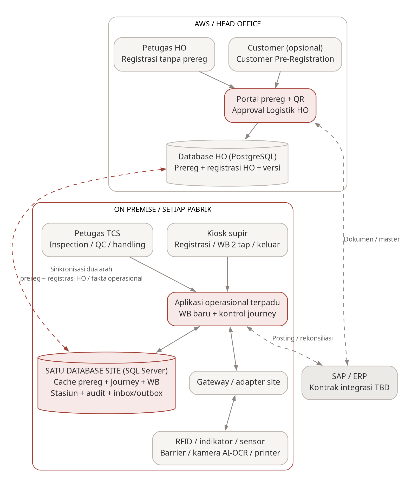

# Catatan Teknis AWB-DWS

Untuk tim pengembang. Ringkasan untuk manajemen ada di `BLUEPRINT.md` dan dicetak sebagai PDF. Keputusan dan riwayat memakai nomor bersama dengan blueprint (K-xx, R-xx).

## Cara memperbarui

Perbarui dokumen ini **dalam perubahan yang sama** setiap kali Anda:

- menambah, mengganti nama atau menghapus aplikasi, domain, modul, fitur frontend, adapter perangkat atau paket bersama
- menambah atau mengubah endpoint, model Prisma, migrasi atau contract
- menyambungkan sistem luar (sinkronisasi HO, SAP, controller, kamera, printer)
- mengambil keputusan teknis

Mana yang masuk ke mana:

| Hal                                                                                                                  | Dokumen                                 |
| -------------------------------------------------------------------------------------------------------------------- | --------------------------------------- |
| Daftar teknis (bagian A–H), keputusan teknis, riwayat teknis                                                         | `TECHNICAL.md`                          |
| Progres per area, keputusan yang berdampak ke bisnis, hal yang perlu diputuskan, riwayat yang penting bagi manajemen | `BLUEPRINT.md`, dengan bahasa sederhana |

Langkahnya:

1. Isi atau ubah baris di bagian A–H. Tulis identifier sebagai inline code persis seperti yang dicetak `npm run check:blueprint` (pola modul: `<system>/<role>/domains/<domain>/<module>`).
2. Status teknis: **direncanakan** (sudah disepakati, belum ada kode) · **kerangka** (sudah tersambung, logika masih sementara) · **dikerjakan** · **selesai** · **dihentikan**.
3. Cantumkan kebutuhan yang dipenuhi (PRD `FR-xxx`, `UI-xx`, keputusan `D-xx` atau hal terbuka `O-xx`) bila ada.
4. Bila progres sebuah area berubah, perbarui juga bagian 3 di `BLUEPRINT.md` (status: Belum mulai · Persiapan · Dikerjakan · Selesai).
5. Tambahkan baris riwayat dengan nilai **sebelumnya**, **sekarang** dan **alasannya**: di sini untuk hal teknis, di `BLUEPRINT.md` untuk hal yang penting bagi manajemen.
6. Sebelum blueprint dibagikan, buat ulang PDF: `npm run blueprint:pdf` (sekali saja: `npm run docs:setup`).

Aturan riwayat (berlaku untuk kedua dokumen):

- Daftar, progres dan hal yang perlu diputuskan menggambarkan **kondisi sekarang** dan boleh diubah. Nilai lamanya disimpan di riwayat.
- Riwayat **hanya boleh ditambah**. Baris lama tidak diubah atau dihapus; koreksi ditulis sebagai baris baru.
- Keputusan **tidak dihapus atau ditimpa**. Bila keputusan berubah, tambahkan keputusan baru (K-xx berikutnya) dan ubah status keputusan lama menjadi "digantikan oleh K-xx". Hanya kolom Status yang boleh berubah.
- Nomor K-xx dan R-xx dipakai bersama di kedua dokumen; ambil nomor berikutnya yang belum terpakai.

`npm run check` menjalankan `npm run check:blueprint`, yang gagal bila:

- kode memiliki sesuatu yang tidak tercantum di bagian A–H; endpoint dan keputusan tidak terdeteksi otomatis, jadi catat sendiri
- baris riwayat diubah atau dihapus, atau keputusan dihapus atau ditimpa, di salah satu dokumen, dibandingkan dengan commit terakhir (di CI, set `BLUEPRINT_BASE`, misalnya `origin/main`)
- salah satu dokumen berubah tanpa baris riwayat baru

Pemeriksaan ini juga memberi peringatan bila PDF lebih lama dari `BLUEPRINT.md`.

## Arsitektur

Susunan folder, aturan dan perintah ada di `README.md`. Penamaan tabel dan kolom ada di `docs/design/penamaan-tabel.md`, protokol controller di `docs/design/protokol-controller.md`.

## Aturan penamaan tabel

Tabel master memakai awalan `mst_`, tabel transaksi `awb_`. Kolom memakai `snake_case`, dengan `id`, `<tabel>_id`, `is_`, `_at`, `_date` dan `_by`. Aturan lengkap dan contohnya ada di `docs/design/penamaan-tabel.md`.

## Keputusan teknis

| ID   | Tanggal    | Keputusan                                                                                                                                                                                                             | Alasan                                                                            | Status               |
| ---- | ---------- | --------------------------------------------------------------------------------------------------------------------------------------------------------------------------------------------------------------------- | --------------------------------------------------------------------------------- | -------------------- |
| K-01 | 2026-11-02 | Satu repositori; aplikasi dikelompokkan per sistem (`apps/prereg`, `apps/site`)                                                                                                                                       | Ketiga aplikasi lama berada di satu tempat dengan pemisahan yang jelas            | berlaku              |
| K-02 | 2026-11-02 | WB.NET dan TCS menjadi domain di dalam satu layanan pabrik, bukan aplikasi terpisah                                                                                                                                   | Keduanya memakai satu database pabrik dan harus tersimpan bersamaan               | berlaku              |
| K-03 | 2026-11-02 | Usulan awal: aplikasi gateway terpisah untuk perangkat timbangan                                                                                                                                                      | Memisahkan koneksi perangkat dari layanan utama                                   | digantikan oleh K-04 |
| K-04 | 2026-11-02 | Koneksi perangkat ada di layanan pabrik (TCP ke controller, 2 per jembatan timbang); kiosk hanya menampilkan                                                                                                          | Keputusan pemilik kebutuhan                                                       | berlaku              |
| K-05 | 2026-11-02 | Usulan awal: pnpm workspaces                                                                                                                                                                                          | Aturan dependensi yang lebih ketat                                                | digantikan oleh K-06 |
| K-06 | 2026-11-02 | npm workspaces dan Turborepo                                                                                                                                                                                          | Preferensi pemilik                                                                | berlaku              |
| K-07 | 2026-11-02 | TypeScript 7 (versi terbaru)                                                                                                                                                                                          | Versi terbaru saat kerangka dibuat                                                | digantikan oleh K-08 |
| K-08 | 2026-11-02 | TypeScript dikunci di versi 6.0                                                                                                                                                                                       | dependency-cruiser dan typescript-eslint belum mendukung TypeScript 7             | berlaku              |
| K-09 | 2026-11-02 | Aturan pemisahan modul diperiksa otomatis (dependency-cruiser)                                                                                                                                                        | Menjaga batas antar aplikasi, domain, perangkat dan akses data                    | berlaku              |
| K-11 | 2026-11-02 | Prisma 7.10.1 dengan driver adapter                                                                                                                                                                                   | Rilis stabil; tag `latest` di npm menunjuk ke kandidat rilis 8.0                  | berlaku              |
| K-12 | 2026-11-02 | Blueprint dengan riwayat yang tidak ditimpa, diperiksa otomatis dan dicetak sebagai PDF                                                                                                                               | Manajemen dapat melihat kondisi terkini sekaligus perjalanan perubahannya         | berlaku              |
| K-14 | 2026-11-02 | Format pesan controller diambil dari VCF; controller di Priscolin diasumsikan bertipe sama                                                                                                                            | Keputusan pemilik kebutuhan; dipastikan saat survei/FAT                           | digantikan oleh K-17 |
| K-17 | 2026-11-02 | Format tap RFID dan perintah controller sama persis dengan VCF (boleh diperbaiki bila perlu); logika sensor auto-close barrier dapat berubah karena jenis sensor berbeda                                              | Keputusan pemilik kebutuhan                                                       | berlaku              |
| K-18 | 2026-11-02 | Acuan struktur customer_prereg adalah branch `dev_1.3.1/bc`, ditambah 2 perbaikan terbaru di `production`                                                                                                             | `bc` 66 commit lebih maju, cocok dengan database dan sudah mendukung PO sebagian  | berlaku              |
| K-20 | 2026-11-02 | Layanan pabrik menyediakan API dengan alamat dan format yang sama dengan VCF untuk aplikasi Android                                                                                                                   | Aplikasi cukup diganti alamat servernya                                           | berlaku              |
| K-23 | 2026-11-02 | Blueprint untuk manajemen (`BLUEPRINT.md`, dicetak PDF) dipisah dari catatan teknis (`TECHNICAL.md`)                                                                                                                  | Blueprint terlalu teknis untuk manajemen                                          | berlaku              |
| K-24 | 2026-11-02 | Satu file `prisma/schema.prisma` per aplikasi (prereg dan site), berisi semua model aplikasi itu                                                                                                                      | Lebih rapi daripada satu file `.prisma` per domain/modul                          | berlaku              |
| K-25 | 2026-11-02 | Nama tabel memakai awalan `mst_` (master), `awb_` (transaksi) dan `sys_` (teknis), `snake_case` dan bentuk tunggal                                                                                                    | Jenis data langsung terlihat dari nama tabelnya                                   | digantikan oleh K-27 |
| K-26 | 2026-11-02 | Schema database dibiarkan kosong (tanpa model dan migrasi); tabel dan migrasi pertama dibuat tim pengembang mengikuti aturan penamaan. Modul contoh tetap ada sebagai kerangka dan menyimpan data sementara di memori | Tabel dirancang oleh tim; repo hanya memberi kerangka dan panduan                 | berlaku              |
| K-27 | 2026-11-03 | Aturan nama tabel cukup dua awalan: `mst_` untuk data master dan `awb_` untuk data transaksi; selebihnya bebas asal jelas                                                                                             | Aturan K-25 terlalu ketat; keputusan pemilik kebutuhan                            | berlaku              |
| K-28 | 2026-11-03 | Nama kolom memakai `snake_case` berbahasa Inggris: kunci utama `id`, relasi `<tabel>_id`, ya/tidak `is_`/`has_`, waktu `_at`, tanggal `_date`, pengguna `_by`; setiap tabel punya `created_at` dan `updated_at`       | Tim butuh panduan singkat yang sama untuk kedua database                          | berlaku              |
| K-29 | 2026-11-05 | PostgreSQL memakai native UUID; id baru dibuat dengan UUIDv7. Password memakai bcrypt; verifikasi SHA-256 lama hanya lewat flag migrasi eksplisit                                                                     | Penyatuan dua rancangan database, efisiensi indeks dan permintaan pemilik         | berlaku              |
| K-30 | 2026-11-05 | Identitas berasal dari sesi acak yang digest-nya disimpan di PostgreSQL; role dan izin dibaca dari database. Cookie HTTP-only, pemeriksaan Origin dan pembatalan sesi diterapkan                                      | Header role dari client tidak dapat dipercaya                                     | berlaku              |
| K-31 | 2026-11-05 | Daftar transaksi memakai cursor; pencarian memakai indeks trigram; upload dialirkan ke disk privat dengan batas ukuran; pool koneksi dibatasi per instance                                                            | Menghindari pemuatan seluruh data/file ke memori dan koneksi database tanpa batas | berlaku              |

| K-32 | 2026-11-05 | Frontend memakai pages per domain/aksi, layout terpisah, domain hooks dan types, React Hook Form, TanStack Query dan alias sumber yang diperiksa | Struktur dan tipe konsisten; halaman tidak mencampur HTTP, state server dan navigasi | berlaku |
| K-33 | 2026-11-06 | Semua login memakai mst_user dengan account_type; kode SAP dimasukkan sebagai username tanpa master/link mitra. Kota disimpan sebagai teks di record terkait | Model akun dan input manual yang diminta pemilik; menghapus relasi yang tidak diperlukan | berlaku |

## Riwayat teknis

| No    | Tanggal    | Area                       | Sebelumnya                                                                                                                                                                                                  | Sekarang                                                                                                                                                                                                                                          | Alasan / referensi                                            |
| ----- | ---------- | -------------------------- | ----------------------------------------------------------------------------------------------------------------------------------------------------------------------------------------------------------- | ------------------------------------------------------------------------------------------------------------------------------------------------------------------------------------------------------------------------------------------------- | ------------------------------------------------------------- |
| R-004 | 2026-11-02 | Repositori                 | —                                                                                                                                                                                                           | Kerangka repositori: aplikasi prereg dan site, paket bersama, aturan pemisahan modul dan pengujian                                                                                                                                                | K-01, K-02, K-09                                              |
| R-005 | 2026-11-02 | Perangkat                  | Usulan aplikasi gateway terpisah untuk perangkat                                                                                                                                                            | Koneksi TCP ke controller di layanan pabrik; kiosk hanya tampilan                                                                                                                                                                                 | K-03 → K-04                                                   |
| R-006 | 2026-11-02 | Tooling                    | Usulan pnpm; TypeScript 7                                                                                                                                                                                   | npm workspaces; TypeScript 6.0                                                                                                                                                                                                                    | K-05 → K-06; K-07 → K-08                                      |
| R-007 | 2026-11-02 | Database                   | Engine belum ditetapkan (PRD O-06); repository menyimpan data sementara di memori                                                                                                                           | PostgreSQL untuk Customer Pre-Registration dan SQL Server untuk pabrik, dengan migrasi awal                                                                                                                                                       | PRD D-19, PRD v0.4; K-10, K-11                                |
| R-008 | 2026-11-02 | Dokumentasi                | —                                                                                                                                                                                                           | Blueprint dengan pemeriksaan otomatis, riwayat yang tidak ditimpa dan versi PDF                                                                                                                                                                   | K-12                                                          |
| R-010 | 2026-11-02 | Perangkat                  | Format pesan controller belum diketahui                                                                                                                                                                     | Format diambil dari VCF (`:W1<kartu>!`, `:INPn!`, `:PING!`, `:OPENn!`); belum diterapkan                                                                                                                                                          | K-14                                                          |
| R-014 | 2026-11-02 | Perangkat                  | Controller Priscolin diasumsikan sama dengan VCF                                                                                                                                                            | Format tap RFID dan perintah sama persis; logika sensor auto-close barrier dapat berubah                                                                                                                                                          | K-14 → K-17                                                   |
| R-015 | 2026-11-02 | Dokumentasi                | —                                                                                                                                                                                                           | Inventaris tabel sistem lama (usulan salin/ubah/tidak dipakai) dan protokol controller lengkap ditulis di `docs/design/`                                                                                                                          | K-13, K-17                                                    |
| R-016 | 2026-11-02 | Database                   | 6 pertanyaan terbuka di inventaris tabel; API aplikasi Android belum diputuskan                                                                                                                             | 4 diputuskan: acuan branch, master supir/kendaraan/transporter di HO, API meniru VCF, akun layanan SAP; layar re-adopt dan ekspor struktur WB.NET masih terbuka                                                                                   | K-18 s.d. K-21                                                |
| R-017 | 2026-11-02 | Perangkat                  | R-010 menulis format input controller sebagai `:INPn!`                                                                                                                                                      | Koreksi: format input yang benar adalah `:INP<n><0/1>;`, diakhiri titik koma (lihat `docs/design/protokol-controller.md`)                                                                                                                         | Koreksi atas R-010                                            |
| R-019 | 2026-11-02 | Dokumentasi                | Blueprint berisi hal untuk manajemen dan hal teknis sekaligus                                                                                                                                               | Blueprint (manajemen, PDF) memakai bahasa sederhana; keputusan teknis, riwayat teknis dan daftar teknis pindah ke `TECHNICAL.md` tanpa mengubah isi barisnya                                                                                      | K-23                                                          |
| R-020 | 2026-11-02 | Database                   | Satu file `.prisma` per domain/modul di folder `prisma/schema/`                                                                                                                                             | Satu `prisma/schema.prisma` per aplikasi; model dan migrasi tidak berubah                                                                                                                                                                         | K-24                                                          |
| R-021 | 2026-11-02 | Database                   | Belum ada aturan penamaan tabel                                                                                                                                                                             | Awalan `mst_` (master), `awb_` (transaksi) dan `sys_` (teknis), `snake_case`, bentuk tunggal                                                                                                                                                      | K-25                                                          |
| R-022 | 2026-11-02 | Database                   | Model contoh `Journey` dan `PreRegistration` dengan migrasi awal di kedua database                                                                                                                          | Schema tanpa model dan migrasi; modul contoh tetap ada dan menyimpan data sementara di memori; tabel contoh di database lokal dihapus                                                                                                             | K-26                                                          |
| R-023 | 2026-11-03 | Database                   | Awalan `mst_` (master), `awb_` (transaksi) dan `sys_` (teknis), `snake_case`, bentuk tunggal, aturan model dan kolom Prisma                                                                                 | Hanya awalan `mst_` (master) dan `awb_` (transaksi); selebihnya bebas asal jelas                                                                                                                                                                  | K-25 → K-27                                                   |
| R-024 | 2026-11-03 | Perangkat                  | `docs/design/protokol-controller.md` merujuk beberapa sumber dan membandingkan dua implementasi lama                                                                                                        | Hanya merujuk kode VCF di GitHub; isinya fungsi tiap relay dan input, dan cara layanan pabrik menanganinya (satu koneksi, tap, auto-close, buka dari aplikasi, sirene)                                                                            | Permintaan pemilik kebutuhan; K-17                            |
| R-025 | 2026-11-03 | Infrastruktur              | Jaringan Docker database lokal dipilih otomatis oleh Docker (`172.22.0.0/16`), bentrok dengan jaringan kantor sehingga server internal di `172.22.x.x` tidak terjangkau                                     | Subnet dipatok ke `192.168.243.0/24` di `infra/dev/compose.yaml`                                                                                                                                                                                  | Jaringan kantor memakai `172.22.0.0/16`                       |
| R-026 | 2026-11-03 | Database                   | Belum ada aturan nama kolom                                                                                                                                                                                 | `snake_case` berbahasa Inggris dengan `id`, `<tabel>_id`, `is_`/`has_`, `_at`, `_date`, `_by`; setiap tabel punya `created_at` dan `updated_at`                                                                                                   | K-28                                                          |
| R-027 | 2026-11-03 | Dokumentasi                | `docs/design/inventaris-tabel.md`: usulan salin/ubah/tidak dipakai untuk setiap tabel sistem lama                                                                                                           | `docs/design/penamaan-tabel.md`: panduan singkat nama tabel dan kolom; struktur tabel lama dilihat langsung oleh tim. Keputusan dari inventaris tetap di K-18 s.d. K-22, hal terbuka tetap di `BLUEPRINT.md`                                      | Permintaan pemilik kebutuhan                                  |
| R-028 | 2026-11-03 | Pengujian                  | `tests/global-setup.ts` menjalankan migrasi lewat `npx prisma`; di Windows gagal karena `npx.cmd` tidak bisa dijalankan tanpa shell, dan pesannya tertutup error Vitest `code.charCodeAt is not a function` | Prisma CLI dijalankan langsung dengan Node (`process.execPath`); pesan gagal setup selalu dicetak lebih dulu                                                                                                                                      | `npm run check` gagal di laptop Windows pengembang            |
| R-029 | 2026-11-04 | Frontend                   | Halaman prereg/web berupa kerangka sederhana tanpa autentikasi                                                                                                                                              | Halaman login publik dan alur lupa password dengan verifikasi OTP email (AWB-6); pemisahan logic (pages/auth) dan presentasi (components/auth), routing dengan React.lazy, serta penambahan komponen Button, Input, dan AuthLayout di packages/ui | Kebutuhan antarmuka AWB-6                                     |
| R-030 | 2026-11-04 | Frontend                   | Belum ada antarmuka pengelolaan pengguna (admin) di prereg/web                                                                                                                                              | Halaman admin user management untuk akun mitra dan internal (AWB-8) dengan filter peran/pabrik/pencarian, form tambah akun (CUSTOMER, VENDOR, internal), ubah/nonaktifkan status, reset password, dan komponen Table terstruktur di packages/ui   | Kebutuhan antarmuka AWB-8                                     |
| R-031 | 2026-11-05 | Database                   | Schema database prereg masih kosong (tanpa model dan tabel akun/peran/mitra)                                                                                                                                | Skema tabel Prisma untuk akun, peran, hak akses, mitra SAP (customer, vendor, interco), relasi multi-kode mitra, pembatasan pabrik, dan OTP (AWB-2); migrasi awal PostgreSQL lokal dan seeder data peran serta 16.000+ data mitra dari referensi  | Kebutuhan database AWB-2                                      |
| R-032 | 2026-11-05 | Backend                    | Belum ada API pengelolaan akun internal dan autentikasi peran                                                                                                                                               | Endpoint CRUD akun internal (ADMIN only), password generator & mailer service, verifikasi peran, penugasan akses pabrik, dan blokir login akun nonaktif (AWB-7)                                                                                   | Kebutuhan API AWB-7                                           |
| R-033 | 2026-11-05 | Fullstack                  | Belum ada pengaturan hak akses dinamis dan proteksi izin halaman/menu                                                                                                                                       | Modul role-permission dan middleware requirePermission di prereg/api, penolakan akses tidak berhak (403), serta antarmuka dinamis menu role & halaman matriks izin peran di prereg/web (AWB-9)                                                    | Kebutuhan antarmuka & keamanan AWB-9                          |
| R-034 | 2026-11-05 | Pre-Registration           | Belum ada fitur pembuatan akun mitra oleh admin                                                                                                                                                             | Pembuatan akun mitra (Customer, Vendor, Interco) oleh admin, relasi ke kode SAP (KUNNR, LIFNR, Interco), generate password acak, hashing, pengiriman kredensial & reset via email SMTP                                                            | AWB-3                                                         |
| R-035 | 2026-11-05 | Pre-Registration           | Belum ada API login, sesi dan pemeriksaan peran                                                                                                                                                             | API autentikasi (/api/auth/login, /api/auth/logout, /api/auth/me), sesi via cookie httpOnly, peran diverifikasi dari database server, rate limiting login, dan middleware requireAuth/requireRole                                                 | Login, sesi dan pemeriksaan peran (API)                       |
| R-036 | 2026-11-05 | Pre-Registration           | Belum ada fitur reset password mandiri dengan OTP                                                                                                                                                           | Reset password mandiri via OTP email (/api/auth/forgot-password dan /api/auth/reset-password), auto-generate password baru, dan invalidasi sesi lama                                                                                              | AWB-5                                                         |
| R-037 | 2026-11-05 | Pre-Registration           | Belum ada skema data master supir, kendaraan, transporter, kota dan pengajuan registrasi truk                                                                                                               | Tabel master (mst_city, mst_transporter, mst_driver, mst_vehicle), pengajuan (awb_driver_request), jejak keputusan (awb_driver_request_decision), migrasi dan seed kota & transporter                                                             | Tabel supir, kendaraan, transporter dan pengajuan             |
| R-038 | 2026-11-05 | Pre-Registration           | Belum ada fitur upload dokumen dan foto supir/SIM/STNK                                                                                                                                                      | API upload dokumen lokal siap S3 (/api/documents/upload), validasi format/ukuran (maks 5MB), pembatasan akses (/api/documents/:category/:fileName), dan tabel awb_document                                                                        | AWB-11                                                        |
| R-039 | 2026-11-05 | Integrasi dan pengamanan   | Rancangan akun terpisah, integer dan UUID, sesi/header role yang tidak seragam, email dan UI simulasi                                                                                                       | Satu skema UUIDv7, bcrypt, sesi PostgreSQL, izin API, UI tersambung, penyimpanan privat, indeks/pool/cursor, audit dan ESLint/Prettier. Klaim email/OTP di riwayat awal belum menjadi layanan produksi; keduanya ditunda sesuai R-040             | K-29, K-30, K-31; integrasi dua branch dan permintaan pemilik |
| R-041 | 2026-11-05 | Validasi dan kerapian kode | Validator format berantai yang deprecated dan belum ada pemeriksaan gaya kode                                                                                                                               | Validator top-level Zod 4, tipe respons bersama, ESLint untuk mencegah pola lama, Prettier, perbaikan label input dan pengujian browser                                                                                                           | Permintaan pemilik                                            |

| R-042 | 2026-11-05 | Struktur frontend | Halaman, komponen dan request belum memiliki batas yang seragam | Pages per domain/aksi, hooks dan types terpisah, layout autentikasi/izin, URL filter, query cache dan konvensi di docs/design/frontend.md; alias sumber diperiksa | K-32; permintaan pemilik |
| R-043 | 2026-11-05 | Tampilan prereg | Tampilan awal memakai CSS komponen tunggal | Prereg memakai token Tailwind, ikon, dan komponen visual lokal bertipe; sesi, hooks, routing dan API tetap sama | Penyempurnaan tampilan dan permintaan pemilik |

| R-044 | 2026-11-05 | Penyempurnaan antarmuka | Gambar login tidak digunakan, logo/sidebar meluber saat ringkas dan kontrol daftar kurang konsisten | Gambar pada panel login yang tetap terpisah, logo ringkas tanpa teks tambahan, tabel kompak, aksi berlabel aksesibel, filter berlabel dan hapus filter; diperiksa melalui browser | Permintaan pemilik |

| R-045 | 2026-11-05 | Akun development | Seed menghasilkan password acak dan mempertahankan password akun lama | Seed khusus development menetapkan password123 untuk admin dan akun contoh mitra, memakai bcrypt dengan salt terpisah dan membatalkan sesi saat reseed | Permintaan pemilik |

| R-046 | 2026-11-05 | Pengalaman administrasi | Matriks izin lebar, filter tetap dan profil di header | Daftar peran dan editor izin per modul, ikon MUI outlined, profil/sign-out di footer sidebar, toggle di header, tema netral dan filter server all/any bertipe dengan maksimal 12 aturan serta indeks pencarian/tanggal tambahan | Permintaan pemilik |

| R-047 | 2026-11-05 | Sistem komponen dan halaman akun | Komponen bersama datar, konfirmasi browser dan daftar izin/peran tanpa pagination server | UI atoms/molecules/organisms/providers/templates, tema light/dark/system di semua frontend, dialog kustom, Table dengan pagination server default 20; pencarian role/izin di API dan pilihan izin lintas halaman dipertahankan; formulir akun ditulis ulang per bagian | Permintaan pemilik |
| R-048 | 2026-11-06 | Tema dan identitas akun mitra | Kontrol tema di navbar, permukaan gelap kebiruan, pemilihan koneksi SAP dan ikon pencarian menimpa teks | Ikon tema di sign-in/footer sidebar, dark charcoal netral; username mitra memakai kode SAP yang di-resolve API, koneksi lama dipertahankan saat edit; kode SAP tampil sebagai teks dan Input memiliki slot leadingIcon dengan padding bersama | Permintaan pemilik |
| R-049 | 2026-11-06 | Sorting tabel dan lookup akun | Header tabel statis dan label role/preview hilang sementara saat query SAP berganti | Header data dapat diklik untuk urutan asc/desc dari API sebelum pagination; URL menyimpan sorting, page direset ke 1 dan ID menjadi pembeda stabil. Katalog izin tetap berkelompok, pilihan draft dipertahankan; opsi akun mempertahankan hasil sebelumnya selama lookup SAP. Username SAP tetap read-only saat edit | Permintaan pemilik |
| R-050 | 2026-11-06 | Validasi awal formulir akun | Pergantian tipe/role memvalidasi username yang baru dikosongkan sehingga error muncul sebelum diisi | Pergantian tipe/role mereset nilai, error dan touched username tanpa validasi; nilai profil lain tetap dipertahankan dan validasi wajib tetap dijalankan saat submit | Laporan pemilik |
| R-051 | 2026-11-06 | Tipografi dan filter akun | Font HTML berbeda dari komponen, label kecil dan UI builder aturan kompleks | Font Inter Variable lokal dari paket UI, ukuran dan bobot konsisten; builder diganti dropdown Roles/Plants multi-select dengan search/checkbox, pilihan tersimpan di URL dan diterapkan server sebelum sorting/count/pagination; OR dalam kelompok, AND antar kelompok | Permintaan pemilik |
| R-052 | 2026-11-06 | Loading dan fixture pengujian lokal | Spinner untuk loading, ikon dekoratif pada halaman izin dan delapan role seed dengan dua akun | Skeleton/PageSkeleton bersama untuk halaman, tabel, opsi dan tombol; ikon dekoratif peran/izin dihapus; seed menyisakan ADMIN/LOGISTIC/COMMERCIAL/CUSTOMER/VENDOR dan akun per role dengan bcrypt password123, izin awal serta akses pabrik | Permintaan pemilik |
| R-053 | 2026-11-06 | Organisasi seed dan komentar schema | Seed datar, bootstrap admin terpisah dan komentar schema tidak sesuai fitur terkini | prisma/seed/index.ts dan master.ts, perintah Prisma terkonfigurasi; bootstrap dihapus, pembuatan admin hanya dalam seed development; komentar Prisma dirapikan tanpa perubahan struktur database | Permintaan pemilik |
| R-054 | 2026-11-06 | Daftar akun dengan banyak akses pabrik | Kode SAP/tipe akun terpisah dan seluruh pabrik dirender sebagai badge; respons daftar memuat semua relasi | Enam kolom User/Role/Contact/Plant access/Status/Actions; SAP di identitas, tipe di bawah roleName, pabrik berupa hitungan/preview dan popover searchable. API daftar memakai count serta take 2, detail lengkap diambil saat dibuka; sorting role memakai nama dan Contact memakai email | Permintaan pemilik |
| R-055 | 2026-11-06 | Skeleton mengikuti tampilan dan aksi izin | Skeleton halaman generik dan bentuk sel seragam; aksi izin berupa teks | Skeleton per route dengan layout form/summary, editor izin, auth dan tabel; lebar kolom serta bentuk sel dibagi dengan view nyata, shell tetap terlihat saat lazy loading. Manage permissions menjadi tombol ikon dengan tooltip/label aksesibel | Permintaan pemilik |
| R-056 | 2026-11-06 | Penyederhanaan label tabel | Prefix SAP sebelum username dan badge status aktif/nonaktif | Username ditampilkan langsung; status akun/peran memakai teks biasa dan skeleton teks. Kolom Actions memiliki judul di atas ikon gear | Permintaan pemilik |
| R-057 | 2026-11-06 | Header daftar ringkas | Total akun di subtitle serta subtitle/banner penjelasan role | Header daftar menampilkan judul/aksi saja; total akun dan tiga teks pengantar peran dihapus, skeleton mengikuti tinggi/layout baru. Total hasil tetap di pagination dengan placeholder saat loading | Permintaan pemilik |
| R-058 | 2026-11-06 | Avatar sidebar | Tile gelap berisi inisial pengguna | Ikon profil MUI dalam lingkaran netral, dengan placeholder skeleton lingkaran yang sama | Permintaan pemilik |
| R-059 | 2026-11-06 | Penghapusan master kota | City/mst_city dan foreign key pada transporter, supir serta pengajuan | Migrasi menyalin nama kota ke city/driver_city lalu menghapus foreign key dan tabel kota; seed transporter memakai teks langsung | K-33; permintaan pemilik |
| R-060 | 2026-11-06 | Akun mitra langsung di mst_user | Master Partner/UserPartner, lookup SAP, login alias serta seed/import Excel | Partner dan link dihapus; lokasi primer dipindah ke User.city/country, ID/login tetap. Input manual CUSTOMER/VENDOR langsung ke mst_user, login lewat username unik; partnerIds ditolak, opsi hanya role/pabrik, seed Excel/dependensi xlsx dihapus | K-33; permintaan pemilik |
| R-061 | 2026-11-06 | Sinkronisasi pabrik | Pengajuan supir/kendaraan hanya dibaca; belum ada outbox dan endpoint sinkronisasi pabrik | Outbox sinkronisasi atomik pada approval logistik, contract driverVehicleApprovedEvent, endpoint /api/internal/sync (outbox & ack) dengan autentikasi layanan | K-19; AWB-14 |
| R-062 | 2026-11-06 | Sinkronisasi pabrik | Master supir & kendaraan di pabrik belum ada; sync hanya router kosong | Worker berkala di site-api mengambil pesan outbox HO dengan contract driverVehicleApprovedEvent, simpan ke mst_driver & mst_vehicle SQL Server, catat sequence terakhir di sys_sync_state/inbox dan tangani putus koneksi | AWB-15 |

Riwayat dari branch kedua dipetakan R-029 → R-034, R-031 → R-035, R-032 → R-036, R-033 → R-037 dan R-034 → R-038 karena nomornya berbenturan. Isi historis dipertahankan; kondisi terkini dijelaskan di R-039.

## A. Aplikasi

| Aplikasi     | Paket             | Berjalan di                                     | Port (dev) | Database   | Status   |
| ------------ | ----------------- | ----------------------------------------------- | ---------- | ---------- | -------- |
| `prereg/api` | `@awb/prereg-api` | AWS ECS, publik                                 | 3000       | PostgreSQL | kerangka |
| `prereg/web` | `@awb/prereg-web` | AWS, publik                                     | 5173       | —          | kerangka |
| `site/api`   | `@awb/site-api`   | On-premise, tepat satu instance per pabrik      | 4000       | SQL Server | kerangka |
| `site/web`   | `@awb/site-web`   | On-premise                                      | 5174       | —          | kerangka |
| `site/kiosk` | `@awb/site-kiosk` | On-premise, layar sentuh kiosk (hanya tampilan) | 5175       | —          | kerangka |

## B. Domain dan modul backend

### site/api

| Domain                          | Cakupan                                                                            | PRD                                          | Status                     |
| ------------------------------- | ---------------------------------------------------------------------------------- | -------------------------------------------- | -------------------------- |
| `site/api/domains/journey`      | Satu catatan per kunjungan truk: tahap saat ini, pengikatan kartu, audit           | FR-008–FR-010, FR-043                        | kerangka                   |
| `site/api/domains/registration` | Reg IN dan Reg OUT, cache prereg, QR, fallback QR, registrasi tanpa prereg, keluar | FR-001–FR-010, FR-027, FR-029, FR-045–FR-047 | direncanakan (router saja) |
| `site/api/domains/weighbridge`  | Pengganti WB.NET: tap 1/2, penimbangan, OCR, pemeriksaan AI, toleransi, tiket      | FR-011–FR-019, FR-028, FR-048–FR-050         | direncanakan (router saja) |
| `site/api/domains/tcs`          | Alur yang dapat dikonfigurasi, tahap, input stasiun, keputusan QC                  | FR-020–FR-026                                | direncanakan (router saja) |
| `site/api/domains/sync`         | Outbox/inbox dengan HO, rekonsiliasi, klien prereg                                 | FR-031–FR-036, AWB-15                        | selesai                    |
| `site/api/domains/erp`          | Posting ke SAP (keluar saja)                                                       | FR-037, O-07                                 | direncanakan               |

| Modul                              | Fungsi                                                                       | Status   |
| ---------------------------------- | ---------------------------------------------------------------------------- | -------- |
| `site/api/domains/journey/journey` | Membaca journey berdasarkan id (contoh pola modul; data sementara di memori) | kerangka |

### prereg/api

| Modul                                 | Fungsi                                                                                                                                 | PRD            | Status                                                     |
| ------------------------------------- | -------------------------------------------------------------------------------------------------------------------------------------- | -------------- | ---------------------------------------------------------- |
| `prereg/api/modules/pre-registration` | Membaca Customer Pre-Registration berdasarkan id (contoh pola modul; data sementara di memori)                                         | FR-001         | kerangka                                                   |
| `prereg/api/modules/internal-user`    | Pengelolaan akun staf internal (ADMIN only), pembuatan password sistem, reset password, pembatasan akses pabrik, dan autentikasi peran | FR-040, FR-041 | selesai                                                    |
| `prereg/api/modules/role-permission`  | Pengelolaan hak akses izin peran dan menu, penolakan akses terlarang (HTTP 403), dan matriks perizinan peran                           | FR-042         | selesai                                                    |
| `prereg/api/modules/auth`             | Login, logout, profil sesi, throttle bersama dan peningkatan hash lama secara eksplisit                                                | FR-040         | selesai untuk cakupan ini                                  |
| `prereg/api/modules/document`         | Upload JPEG/PNG/PDF privat (5 MB), validasi signature, unduh berdasarkan UUID dan pemeriksaan pemilik/reviewer                         | AWB-11         | selesai lokal; volume persisten diperlukan pada deployment |
| `prereg/api/modules/driver-request`   | Daftar pengajuan terbatas; approval logistik atomik bersama penulisan outbox sinkronisasi                                              | AWB-10, AWB-14 | selesai                                                    |
| `prereg/api/modules/sync`             | Antrean keluar sinkronisasi (outbox) dan konfirmasi terima dari pabrik dengan autentikasi layanan                                      | K-19, AWB-14   | selesai                                                    |

## C. Endpoint API

| Aplikasi   | Metode | Path                                                                                | Modul            | Status                                                                |
| ---------- | ------ | ----------------------------------------------------------------------------------- | ---------------- | --------------------------------------------------------------------- |
| site/api   | GET    | `/health`, `/api/journeys/:id`                                                      | health/journey   | tidak berubah                                                         |
| site/api   | —      | `/api/registration`, `/api/weighbridge`, `/api/tcs`, `/api/sync`                    | router domain    | kerangka                                                              |
| prereg/api | GET    | `/health`                                                                           | app              | selesai                                                               |
| prereg/api | POST   | `/api/auth/login`                                                                   | auth             | bcrypt, cookie sesi; username atau kode SAP yang terhubung            |
| prereg/api | GET    | `/api/auth/me`                                                                      | auth             | identitas dan izin terkini                                            |
| prereg/api | POST   | `/api/auth/logout`                                                                  | auth             | membatalkan token di server                                           |
| prereg/api | GET    | `/api/users`, `/api/users/:id`                                                      | internal-user    | ADMIN; filter dan pagination, maksimum 100 baris                      |
| prereg/api | GET    | `/api/users/options`                                                                | internal-user    | ADMIN; pilihan role dan pabrik                                        |
| prereg/api | POST   | `/api/users`                                                                        | internal-user    | ADMIN; akun mitra/internal, bcrypt, kredensial di console development |
| prereg/api | PUT    | `/api/users/:id`                                                                    | internal-user    | ADMIN; simpan data dan batalkan sesi akun                             |
| prereg/api | PATCH  | `/api/users/:id/status`                                                             | internal-user    | ADMIN; cegah hilangnya admin aktif terakhir                           |
| prereg/api | POST   | `/api/users/:id/reset-password`                                                     | internal-user    | ADMIN; batalkan sesi; development saja hingga delivery tersedia       |
| prereg/api | —      | `/api/internal-users/*`                                                             | internal-user    | alias terautentikasi untuk API akun; tidak lagi memakai header role   |
| prereg/api | GET    | `/api/access/permissions`, `/api/access/roles`, `/api/access/roles/:id/permissions` | role-permission  | ADMIN; katalog dan matriks database                                   |
| prereg/api | PUT    | `/api/access/roles/:id/permissions`                                                 | role-permission  | ADMIN; perubahan atomik dan audit; ADMIN tidak dibatasi               |
| prereg/api | POST   | `/api/documents/upload`                                                             | document         | sesi dan izin upload; kategori sim/driver/stnk; disk streaming        |
| prereg/api | GET    | `/api/documents/:id`                                                                | document         | UUID; hanya pemilik, ADMIN atau LOGISTIC berizin                      |
| prereg/api | GET    | `/api/driver-requests`                                                              | driver-request   | sesi dan izin baca; cursorAt/cursorId, status, limit maksimum 100     |
| prereg/api | POST   | `/api/driver-requests/:id/approve`                                                  | driver-request   | LOGISTIC/ADMIN; approval atomik bersama penulisan event sinkronisasi  |
| prereg/api | GET    | `/api/internal/sync/outbox`                                                         | sync             | autentikasi layanan; kirim pesan sinkronisasi setelah nomor X         |
| prereg/api | POST   | `/api/internal/sync/ack`                                                            | sync             | autentikasi layanan; konfirmasi penerimaan sampai nomor Y             |
| prereg/api | GET    | `/api/pre-registrations/:id`                                                        | pre-registration | dilindungi izin prereg:read; isi masih contoh                         |
| prereg/api | —      | `/api/internal/*`                                                                   | internal         | belum ada handler sinkronisasi; belum siap dipakai pabrik             |

Route contoh `/api/access/protected/*` dan helper publik `/api/access/check-access` dihapus. OTP dan email tidak diaktifkan; self-service recovery menampilkan status belum tersedia. Endpoint pembuatan/reset akun mengembalikan 503 sebelum mutasi pada production hingga delivery tersedia.

## D. Model data dan migrasi

Schema prereg menyatukan akun dan data master/pengajuan. Schema site masih kosong. Migrasi awal UUID dipertahankan; konversi ke native UUID menjaga nilai id dan relasi. Data integer dari database branch lain memerlukan pemetaan terpisah sebelum impor.

| Model                   | Aplikasi · database     | Tabel                         | Status            |
| ----------------------- | ----------------------- | ----------------------------- | ----------------- |
| `User`                  | prereg/api · PostgreSQL | `mst_user`                    | diimplementasikan |
| `Role`                  | prereg/api · PostgreSQL | `mst_role`                    | diimplementasikan |
| `Permission`            | prereg/api · PostgreSQL | `mst_permission`              | diimplementasikan |
| `RolePermission`        | prereg/api · PostgreSQL | `mst_role_permission`         | diimplementasikan |
| `Plant`                 | prereg/api · PostgreSQL | `mst_plant`                   | diimplementasikan |
| `UserPlant`             | prereg/api · PostgreSQL | `mst_user_plant`              | diimplementasikan |
| `UserOtp`               | prereg/api · PostgreSQL | `sys_otp`                     | diimplementasikan |
| `AuthSession`           | prereg/api · PostgreSQL | `auth_session`                | diimplementasikan |
| `AuthRateLimit`         | prereg/api · PostgreSQL | `auth_rate_limit`             | diimplementasikan |
| `AccountAudit`          | prereg/api · PostgreSQL | `account_audit`               | diimplementasikan |
| `Transporter`           | prereg/api · PostgreSQL | `mst_transporter`             | diimplementasikan |
| `Driver`                | prereg/api · PostgreSQL | `mst_driver`                  | diimplementasikan |
| `Vehicle`               | prereg/api · PostgreSQL | `mst_vehicle`                 | diimplementasikan |
| `DriverRequest`         | prereg/api · PostgreSQL | `awb_driver_request`          | diimplementasikan |
| `DriverRequestDecision` | prereg/api · PostgreSQL | `awb_driver_request_decision` | diimplementasikan |
| `Document`              | prereg/api · PostgreSQL | `awb_document`                | diimplementasikan |
| `SyncOutbox`            | prereg/api · PostgreSQL | `sys_sync_outbox`             | diimplementasikan |
| `Driver`                | site/api · SQL Server   | `mst_driver`                  | diimplementasikan |
| `Vehicle`               | site/api · SQL Server   | `mst_vehicle`                 | diimplementasikan |
| `SyncInbox`             | site/api · SQL Server   | `sys_sync_inbox`              | diimplementasikan |
| `SyncState`             | site/api · SQL Server   | `sys_sync_state`              | diimplementasikan |

| Migrasi                               | Aplikasi     | Isi                                                                                                                                                        |
| ------------------------------------- | ------------ | ---------------------------------------------------------------------------------------------------------------------------------------------------------- |
| `20261105041933_init_auth_tables`     | `prereg/api` | Tabel `mst_user`, `mst_role`, `mst_permission`, `mst_role_permission`, `mst_partner`, `mst_user_partner`, `mst_plant`, `mst_user_plant`, `sys_otp` (AWB-2) |
| `20261105050000_native_uuid`          | prereg/api   | Konversi id/relasi TEXT ke UUID dengan mempertahankan nilainya; indeks akun/relasi                                                                         |
| `20261105060000_secure_sessions`      | prereg/api   | Sesi, throttle login bersama, audit; keunikan username/email tanpa membedakan kapital                                                                      |
| `20261105070000_driver_documents`     | prereg/api   | Master kota/transporter/supir/kendaraan, pengajuan, keputusan dan metadata file UUID                                                                       |
| `20261105080000_permissions_search`   | prereg/api   | Katalog izin, pg_trgm untuk pencarian, kode SAP unik per akun                                                                                              |
| `20261105090000_relation_indexes`     | prereg/api   | Indeks foreign key, sesi idle dan kode SAP tanpa membedakan kapital                                                                                        |
| `20261105100000_request_cursor_index` | prereg/api   | Indeks urutan tanggal/UUID untuk daftar transaksi dengan cursor                                                                                            |

| `20261105110000_account_filter_indexes` | prereg/api | Indeks urutan akun, updated_at, trigram phone dan nama pabrik untuk filter server |
| `20261106110000_simplify_account_masters` | prereg/api | Backfill nama kota/lokasi akun; hapus City, Partner dan UserPartner; login langsung mst_user |
| `20261106160000_sync_outbox` | prereg/api | Kolom site_id pada pengajuan dan tabel sys_sync_outbox untuk antrean sinkronisasi pabrik |
| `20261106093604_plant_driver_vehicle_sync` | site/api | Tabel mst_driver, mst_vehicle, sys_sync_inbox dan sys_sync_state di database pabrik (SQL Server) |

## E. Contract (format data antar aplikasi)

Skema di `@awb/contracts`; format sesi/akun dipakai API dan frontend.

| Skema                          | File                              | Dari → ke               | Status                                                            |
| ------------------------------ | --------------------------------- | ----------------------- | ----------------------------------------------------------------- |
| `transactionType`              | `common/transaction.ts`           | semua aplikasi          | terdefinisi                                                       |
| `registrationOrigin`           | `common/transaction.ts`           | semua aplikasi          | terdefinisi                                                       |
| `syncEnvelope`                 | `sync/envelope.ts`                | prereg ↔ site           | terdefinisi, belum dikirim                                        |
| `preregApprovedPayload`        | `sync/prereg-approved.ts`         | prereg → site           | terdefinisi, belum dikirim                                        |
| `preregApprovedEvent`          | `sync/prereg-approved.ts`         | prereg → site           | terdefinisi, belum dikirim                                        |
| `driverVehicleApprovedPayload` | `sync/driver-vehicle-approved.ts` | prereg → site           | terdefinisi                                                       |
| `driverVehicleApprovedEvent`   | `sync/driver-vehicle-approved.ts` | prereg → site           | terdefinisi                                                       |
| `wbSessionPhase`               | `realtime/lane-event.ts`          | site/api → site/kiosk   | terdefinisi                                                       |
| `laneScreenEvent`              | `realtime/lane-event.ts`          | site/api → site/kiosk   | terdefinisi, belum dikirim                                        |
| `sessionUser`                  | `common/account.ts`               | prereg/api → prereg/web | dipakai                                                           |
| `accountChoice`                | `common/account.ts`               | prereg/api → prereg/web | dipakai                                                           |
| `accountProfile`               | `common/account.ts`               | prereg/api → prereg/web | dipakai                                                           |
| `accountListItem`              | `common/account.ts`               | prereg/api → prereg/web | Daftar ringkas, roleName/plantCount dan maksimal dua plantPreview |

| `PERMISSION` | `common/permission.ts` | API dan frontend | konstanta izin bersama |
| `permissionCatalogue` | `common/permission.ts` | API, seed dan frontend | katalog izin bersama |

| `accountFilterFields` | `common/account-filter.ts` | API dan frontend | Daftar field, jenis dan operator yang diizinkan |
| `accountFilterRule` | `common/account-filter.ts` | API dan frontend | Validasi field/operator/nilai |
| `accountFilterSet` | `common/account-filter.ts` | API dan frontend | Match all/any, maksimum 12 aturan |
| `accountSelectionFilters` | `common/account-selection.ts` | API dan frontend | Multi-role dan multi-plant; maksimum 100 pilihan per kelompok |

| `DEFAULT_PAGE_SIZE` | `common/pagination.ts` | API dan UI | Default 20 |
| `paginationQuery` | `common/pagination.ts` | API | Batas page/limit bersama |

| `sortDirection` | `common/sorting.ts` | API dan UI | Validasi asc/desc |
| `accountSortFields` | `common/sorting.ts` | API dan frontend | Allowlist kolom akun |
| `roleSortFields` | `common/sorting.ts` | API dan frontend | Allowlist kolom peran |
| `permissionSortFields` | `common/sorting.ts` | API dan frontend | Allowlist kolom izin |
| `accountSortingQuery` | `common/sorting.ts` | API | Default createdAt desc |
| `roleSortingQuery` | `common/sorting.ts` | API | Default code asc |
| `permissionSortingQuery` | `common/sorting.ts` | API | Default module asc |

## F. Fitur frontend

| Fitur                                                  | Layar PRD                            | Status                            |
| ------------------------------------------------------ | ------------------------------------ | --------------------------------- |
| `site/web/pages/weighbridge/listWeighbridge`           | Menu WB.NET (daftar parity O-01)     | halaman contoh                    |
| `site/web/pages/tcs/listTcs`                           | UI-10, UI-11                         | halaman contoh                    |
| `site/web/pages/dashboard`                             | UI-14, UI-15                         | halaman contoh                    |
| `site/web/pages/admin`                                 | UI-16                                | halaman contoh                    |
| `site/kiosk/pages/registration`                        | UI-03–UI-07, UI-17                   | layar contoh                      |
| `site/kiosk/pages/weighing`                            | UI-08, UI-19, UI-09                  | layar contoh                      |
| `site/kiosk/pages/exit`                                | UI-12, UI-13                         | layar contoh                      |
| `prereg/web/pages/auth/login`                          | Login, sesi saat refresh dan logout  | tersambung API                    |
| `prereg/web/pages/auth/forgotPassword`                 | Pemulihan akun                       | ditunda; status belum tersedia    |
| `prereg/web/pages/user/listUser`                       | Daftar/filter akun, status dan reset | tersambung API                    |
| `prereg/web/pages/user/addUser`                        | Tambah akun mitra/internal           | tersambung API                    |
| `prereg/web/pages/user/editUser`                       | Ubah akun mitra/internal             | tersambung API                    |
| `prereg/web/pages/role/permissionOfRole`               | Matriks izin peran                   | tersambung API                    |
| `prereg/web/pages/dashboard`                           | Ringkasan dan navigasi               | kerangka                          |
| `prereg/web/pages/preRegistration/listPreRegistration` | Daftar prereg                        | kerangka; workflow belum dibangun |
| `prereg/web/pages/approval/listApproval`               | Persetujuan prereg                   | kerangka; workflow belum dibangun |
| `prereg/web/pages/forbidden`                           | Penolakan akses halaman              | selesai                           |
| `prereg/web/pages/notFound`                            | Alamat tidak dikenal                 | selesai                           |

Konvensi folder, nama file, tipe, hooks, forms, session dan routing ada di `docs/design/frontend.md`. Halaman memakai hooks domain; akses HTTP, query cache dan tipe API tidak ditulis ulang di tiap halaman.

| `prereg/web/pages/role/listRole` | Daftar peran, pencarian dan tautan pengelolaan izin | tersambung API |

Route `/roles` menampilkan daftar peran, `/roles/:id/permissions` menampilkan editor per modul, `/roles/permissions` mengarahkan ke daftar untuk kompatibilitas. GET `/api/users` menerima `filters` berupa JSON contract `accountFilterSet`; filter diterapkan sebelum count/pagination dan digabung dengan pencarian/filter lama. Field password dan SQL bebas tidak dapat dipilih. Tanggal memakai hari UTC; pencarian contains memperlakukan persen/underscore sebagai karakter literal.

Form akun mitra memakai kode SAP sebagai username yang dimasukkan manual tanpa lookup/master mitra. Akun INTERNAL/PARTNER berada di mst_user; POST `/api/users` menerima role sesuai tipe, plantIds, profil dan city/country opsional. Username/tipe tetap immutable saat edit. DTO tidak lagi memuat partners dan partnerIds ditolak. GET `/api/users/options` hanya memuat roles/plants dan tidak diulang saat mengetik username. Login hanya melalui username case-insensitive, bukan alias SAP. Lokasi akun lama dipindah dari master primer saat migrasi; master tanpa login disimpan dalam backup lokal privat sebelum dihapus.

GET `/api/users`, `/api/access/roles` dan `/api/access/permissions` menerima sortBy/sortDirection dari allowlist contract. Sorting berlaku sebelum skip/take, dengan ID sebagai tie-breaker dan count/items dalam snapshot RepeatableRead. Akun mendukung nama, username, tipe, role, kode SAP (username mitra), jumlah akses pabrik, status dan tanggal pembuatan. Sorting SAP/pabrik mendahulukan mitra; peran mendukung nama/kode/deskripsi/jumlah izin/status. Izin tetap diurutkan per modul; nama/kode/action dapat diurutkan di dalam modul. Action memakai SQL berparameter dengan arah SQL tetap, bukan interpolasi teks client. ServerSorting/sortKey di Table dan useSorting menyimpan arah di URL, mempertahankan filter/ukuran halaman dan mereset page ke 1. Lookup SAP menggunakan placeholderData hasil sebelumnya agar role dan preview tidak berkedip. Username SAP tetap tidak dapat diubah saat edit.

Daftar akun memakai dropdown MultiSelect Roles dan Plants dari packages/ui, menggantikan builder Advanced. GET `/api/users` menerima repeated query keys roles/plantIds (string tunggal juga diterima), masing-masing maksimum 100, role dibatasi panjangnya dan plant memakai UUID; duplikat dinormalisasi. Query memakai IN/relasi some sebelum sort/count/pagination. Beberapa pilihan dalam satu kelompok memakai OR, antarkelompok memakai AND. URL menyimpan pilihan, search dan sorting; pergantian filter mereset page 1. Parameter legacy tidak diterapkan tersembunyi oleh halaman, tetapi API lama tetap didukung. Tipografi memakai --ui-font-sans dengan Inter Variable self-hosted dari @fontsource-variable/inter; fallback sistem dan font-display swap, tanpa font CDN. Ukuran body/control 14px, metadata 12–13px, label navigasi tidak lagi uppercase berjeda lebar. Lisensi font disertakan di packages/ui/LICENSE-Inter.txt.

## G. Perangkat dan integrasi

| Item                                              | Fungsi                                                                                                                                                                                                                     | Status                                                                                                             |
| ------------------------------------------------- | -------------------------------------------------------------------------------------------------------------------------------------------------------------------------------------------------------------------------- | ------------------------------------------------------------------------------------------------------------------ |
| `site/api/devices/controller`                     | Satu koneksi TCP per controller timbangan (2 per jembatan timbang), sambung ulang otomatis, status di `/health`, `sendToController()` untuk perintah                                                                       | koneksi selesai; format pesan dicatat di `docs/design/protokol-controller.md`, belum diterapkan (data mentah saja) |
| Sinkronisasi HO ↔ pabrik                          | Outbox prereg atomik (AWB-14) dan worker berkala di pabrik mengambil pesan, validasi contract driverVehicleApprovedEvent, simpan master supir/kendaraan ke SQL Server, catat nomor sequence dan tangani offline (AWB-15)   | selesai                                                                                                            |
| SAP / ERP                                         | Posting hasil yang diterima. Akun: saat Logistik approve memakai kredensial SAP petugas (`session_sap`); akses lain memakai satu akun di `SAP_API_CREDENTIALS` (`user:password`, Basic auth) seperti `warehouse_be` (K-22) | direncanakan (kontrak terbuka, O-07)                                                                               |
| Tampilan realtime kiosk (`site/api/src/realtime`) | Mengirim status lane ke layar kiosk                                                                                                                                                                                        | direncanakan                                                                                                       |
| Kamera AI/OCR, indikator, printer                 | Adapter perangkat                                                                                                                                                                                                          | direncanakan (O-05, O-13)                                                                                          |

## H. Paket bersama

| Paket                  | Isi                                                                                         | Status                 |
| ---------------------- | ------------------------------------------------------------------------------------------- | ---------------------- |
| `packages/contracts`   | Skema zod antar aplikasi (bagian E)                                                         | dikerjakan             |
| `packages/server-core` | `CustomError`, `NotFoundError`, `ValidationError`, `errorHandler`, `success()`, `loadEnv()` | selesai untuk saat ini |
| `packages/ui`          | `AppShell`, `Screen`, `Button`, `Input`, `AuthLayout`, `Table`                              | kerangka               |

## Operasional, keamanan dan kapasitas

Komponen bersama mengikuti `packages/ui/README.md`: atoms, molecules, organisms, providers, templates dan token tema. Semua frontend memakai ThemeProvider/ConfirmProvider. Endpoint GET `/api/access/roles` dan `/api/access/permissions` sekarang mengembalikan `{ items, total, page, limit }`, menerima q/page/limit (default 20, maksimum 100; page maksimum 1000). Pencarian dan count dilakukan di server dalam snapshot transaksi; daftar peran hanya memuat jumlah izin. GET `/api/access/roles/:id/permissions` tetap memberi himpunan izin lengkap untuk menjaga pilihan lintas halaman. Pengguna juga default 20. Konfirmasi reset/status/discard memakai dialog bersama, bukan dialog browser.

Panduan menjalankan, migrasi, seed development, rollback, volume privat dan pengujian beban ada di `infra/prereg/README.md`. ESLint dan Prettier dijalankan melalui `npm run check`; `npm run test:e2e` memeriksa sesi dan persistensi lewat browser lokal. Tidak ada pengiriman password pada respons API. Log kredensial hanya aktif pada NODE_ENV=development. Test tidak mencetak kredensial; production menolak provisioning/reset sampai delivery tersedia.

Loading memakai Skeleton/PageSkeleton dari packages/ui: placeholder per sel tabel, halaman/session/detail/options dan tombol, dengan aria-busy/status dan reduced-motion. Ikon dekoratif halaman peran/izin dihapus. Seed dipisah ke apps/prereg/api/prisma/seed/index.ts , accounts.ts dan transporters.ts, terdaftar di prisma.config.ts dan dijalankan lewat prisma db seed. Seluruh entry seed menolak NODE_ENV selain development sebelum perubahan data; bootstrap admin terpisah dihapus. Role seed hanya ADMIN/LOGISTIC/COMMERCIAL/CUSTOMER/VENDOR, dengan akun admin/logistic/commercial/CU00001000/AT11000001, password123 bcrypt dengan salt per akun dan pembatalan sesi saat reseed. Role pensiun hanya dihapus bila tanpa pengguna. Komentar kedua schema Prisma mengikuti kondisi terkini.

Indeks ekspresi lower-case dan GIN trigram dikelola oleh SQL migrasi. Jangan menghapusnya ketika meninjau migrasi hasil Prisma. UUIDv7 dibuat Prisma, disimpan native UUID; data UUID lama tetap sah. Daftar transaksi memakai cursor, daftar admin memakai offset terbatas 1.000 halaman; gunakan filter untuk pencarian lebih dalam. Ukuran pool dikalikan jumlah instance harus berada dalam anggaran koneksi database. Klaim kapasitas memerlukan uji beban di staging dengan ukuran data dan pola penggunaan yang disepakati.
